# Navegación con capturas — Escape Room 7.º B 2026

> Capturas tomadas a **300 × 800 px CSS** (emulación angosta de móvil), con la
> app real y datos sintéticos. Los tiempos son los del recorrido de prueba.
> El mapa textual de pantallas y rutas está en
> [`docs/navegacion-por-app.md`](navegacion-por-app.md).

Este documento recorre la aplicación de punta a punta: la inscripción, las
cinco estaciones, las transiciones, el final, el ranking, las estadísticas, la
administración y las pantallas de error. Incluye **tres intentos completos**
(uno por nivel) y **tres intentos no completados** (por respuestas
incorrectas, por abandono y por tiempo agotado).

## 1. Cómo leer este documento

- Cada bloque indica la **ruta**, el **intento** y el **estado** de la pantalla
  y qué acción sigue.
- Las capturas de **página completa** muestran todo el contenido, aunque sea
  más alto que la pantalla del teléfono. Las capturas de **viewport** muestran
  solo lo que entra en 300 × 800.
- Se usó un viewport CSS de 300 × 800 con densidad 1, modo móvil y táctil. No
  es el tamaño físico del Samsung Galaxy A55 (1080 × 2340, viewport CSS
  aproximado de 384 × 854): es una emulación **más angosta**, elegida para
  forzar el peor caso de ancho.
- Las **tablas** de ranking y de administración tienen scroll horizontal
  interno cuando no entran a 300 px. La página no desborda; la tabla se
  desplaza dentro de su contenedor.
- Los **diálogos nativos** del navegador (`window.confirm` para ayudas,
  abandono y finalizar) no forman parte del HTML y no se capturan. Su texto se
  transcribe en el documento y se muestra la pantalla resultante.
- El **audio** de los 30 segundos tampoco se ve en una foto: se documenta el
  texto titilante y el estado visual.
- Los equipos son sintéticos (`Equipo Demo …`) y los tiempos son los reales
  del recorrido de prueba. **La app nunca muestra ni envía cuál es la opción
  correcta**; las capturas muestran las opciones sin marcar.
- Las imágenes están en `docs/capturas-navegacion/` y se referencian con rutas
  relativas.

## 2. Recorrido público

### 2.1 Bienvenida

- **Ruta:** `/`
- **Estado:** formulario vacío, con las tres dificultades habilitadas.
- **Siguiente:** escribir el nombre del equipo, elegir la cantidad de
  integrantes (1 a 4) y la dificultad, y presionar **Iniciar misión**.

  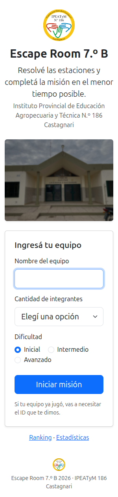

La bienvenida valida en el servidor. Si el nombre ya existe, no crea un equipo
duplicado: pasa a la identificación con el ID del equipo.

- **Ruta:** `/` (envío inválido)
- **Estado:** error de validación inline, sin crear datos.
- **Siguiente:** completar nombre, cantidad y dificultad.

  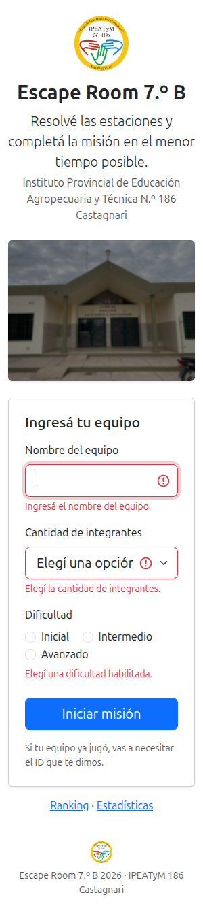

### 2.2 Identificación de equipo

- **Ruta:** `/equipo/identificar`
- **Estado:** el nombre ingresado ya existe; la app pide el ID del equipo que
  se mostró en el HUD.
- **Siguiente:** escribir el ID y confirmar. Un ID incorrecto se rechaza sin
  revelar el nombre ni otros datos. Si el equipo tiene un intento activo, se
  reanuda; si no, se crea uno nuevo.

  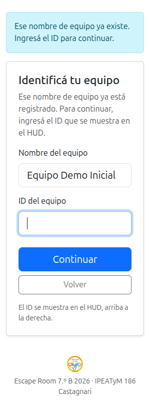

### 2.3 Ranking público

- **Ruta:** `/ranking`
- **Estado:** una tabla por nivel con los intentos completados. A la fecha de
  la captura hay un intento completo por nivel.
- **Siguiente:** el televisor del aula muestra esta vista y la actualiza sola
  cada 8 segundos.

  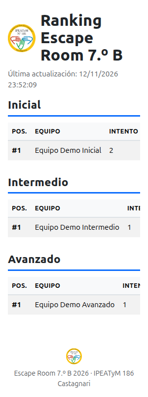

Si falla la consulta de actualización, las tablas se conservan y aparece
**Reconectando…**. Nunca se reemplazan por una pantalla vacía.

- **Ruta:** `/ranking`
- **Estado:** polling caído, datos anteriores conservados.
- **Siguiente:** cuando vuelve la conexión, el estado desaparece.

  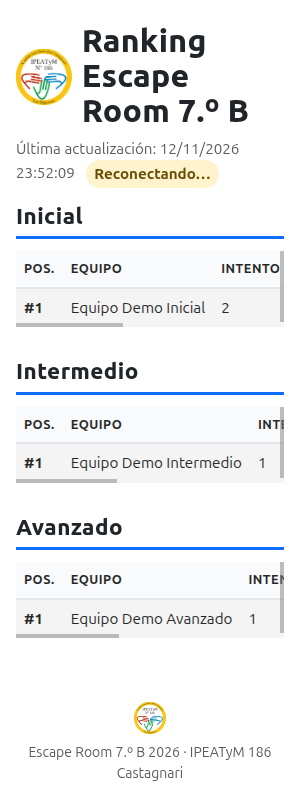

### 2.4 Estadísticas públicas

- **Ruta:** `/estadisticas`
- **Estado:** agregados de la feria sin nombres de equipos ni detalle por
  pregunta: participantes, integrantes, intentos iniciados y completados,
  tiempo promedio y aciertos.
- **Siguiente:** es de solo lectura y accesible sin login.

  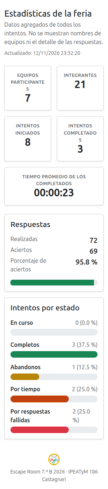

### 2.5 Vista de televisor

- **Ruta:** `/ranking`
- **Estado:** la misma vista pública, a **1920 × 1080**, pensada para leerse a
  distancia en el televisor del aula.
- **Siguiente:** se actualiza sola cada 8 segundos y al volver a la pestaña.

  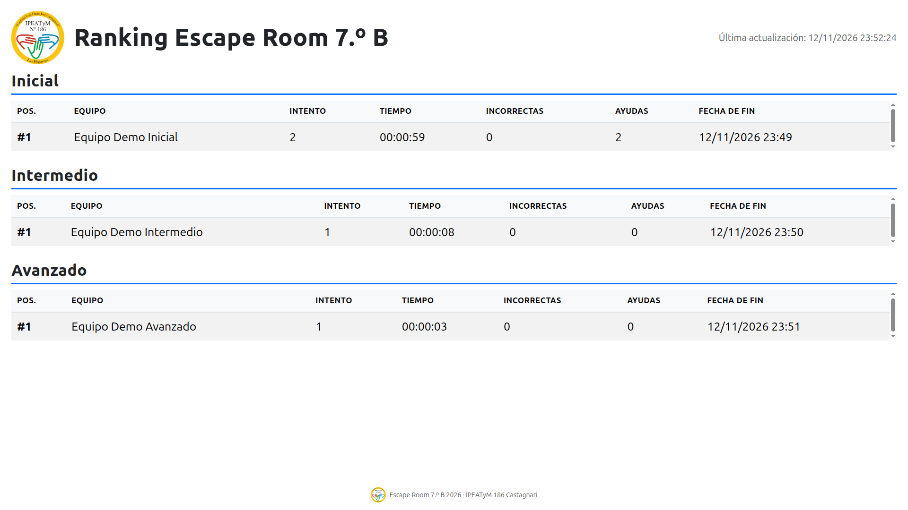

> Esta es la única captura que no mide 300 px de ancho: su objetivo es mostrar
> la vista de TV. Las tablas a 300 px tienen scroll interno, por eso la captura
> de televisor complementa la lectura.

## 3. Recorrido completo · nivel inicial

Intento `Equipo Demo Inicial`, dificultad `inicial`, 3 integrantes. Usa las dos
ayudas en la estación 1 y completa las cinco estaciones sin respuestas
incorrectas, en **00:00:59**. Es el intento número 2 de ese equipo: el intento
anterior se cerró por tiempo durante la preparación de las capturas y no
participa del ranking.

Cada estación muestra siempre el HUD con **ayudas**, **incorrectas**,
**envíos**, **dificultad**, el tiempo total ascendente y el tiempo de estación
descendente.

### 3.1 Estación 1 · Redes

- **Ruta:** `/juego/estacion/1`
- **Estado:** cuatro preguntas del nivel, sin envíos.
- **Siguiente:** marcar una opción por pregunta y **Comprobar respuestas**.

  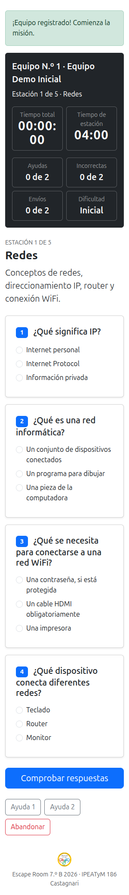

Las ayudas se piden con **Ayuda 1** y **Ayuda 2**, cada una con confirmación.
La app **no muestra el texto de la pista**: los estudiantes de 7.º la leen en
papel. Al llegar a 2 de 2 los botones quedan deshabilitados.

- **Ruta:** `/juego/estacion/1`
- **Estado:** ayudas 2 de 2, sin incorrectas ni envíos.
- **Siguiente:** responder; las ayudas ya no se pueden volver a pedir.

  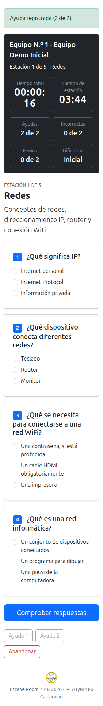

### 3.2 Estación 2 · Hardware

- **Ruta:** `/juego/estacion/2`
- **Estado:** la estación siguiente se prepara al presionar **Continuar**; el
  cronómetro de la estación arranca en ese momento.
- **Siguiente:** responder las cuatro preguntas.

  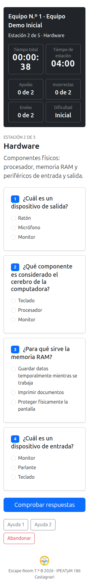

### 3.3 Estación 3 · Internet

- **Ruta:** `/juego/estacion/3`
- **Estado:** cuatro preguntas del nivel inicial.
- **Siguiente:** responder las cuatro preguntas.

  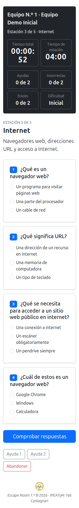

### 3.4 Estación 4 · Ciberseguridad

- **Ruta:** `/juego/estacion/4`
- **Estado:** cuatro preguntas del nivel inicial.
- **Siguiente:** responder las cuatro preguntas.

  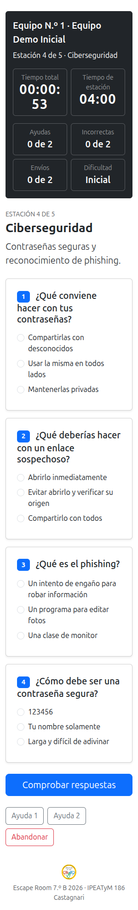

### 3.5 Estación 5 · Sistemas Operativos

- **Ruta:** `/juego/estacion/5`
- **Estado:** última estación. Al registrar las cuatro respuestas correctas, el
  intento se cierra como completo y el tiempo total queda congelado.
- **Siguiente:** pasar a la transición final y ver el resultado.

  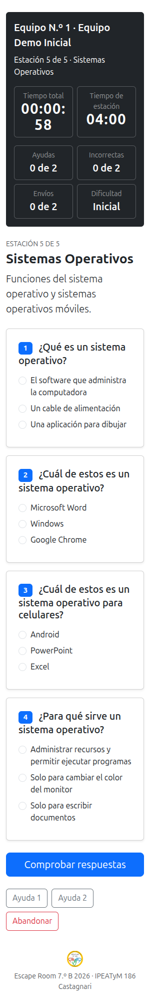

### 3.6 Transiciones

- **Ruta:** `/juego/transicion/1`
- **Estado:** las cuatro respuestas fueron correctas. Se ve el tiempo de la
  estación congelado y el botón **Continuar**; desde las transiciones 1 a 4
  también se puede **Abandonar** con confirmación.
- **Siguiente:** presionar **Continuar** para preparar la estación siguiente.

  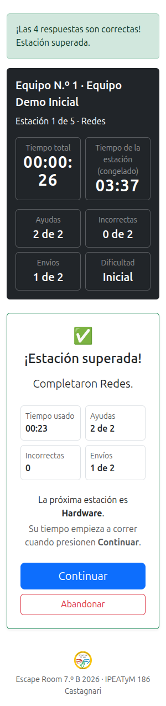

- **Ruta:** `/juego/transicion/5`
- **Estado:** quinta estación superada; el intento ya está completo y el tiempo
  total no sigue subiendo. Solo queda **Ver resultado**.
- **Siguiente:** presionar **Ver resultado**.

  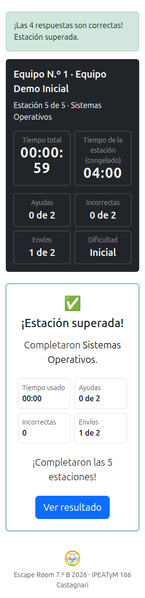

### 3.7 Final del intento

- **Ruta:** `/juego/final`
- **Estado:** intento completo. Muestra el tiempo total, la posición dentro del
  nivel (`#1` Inicial), la posición general, las ayudas, las incorrectas, el
  top 10 del nivel y el ranking completo con filtros.
- **Siguiente:** volver al inicio o abrir las estadísticas.

  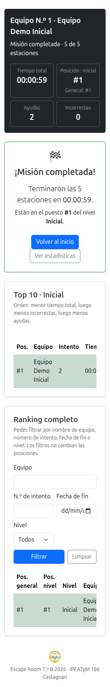

## 4. Recorrido completo · nivel intermedio

Intento `Equipo Demo Intermedio`, dificultad `intermedio`, 3 integrantes. Sin
ayudas ni incorrectas: **00:00:08**.

### 4.1 Estación 1 · Redes

- **Ruta:** `/juego/estacion/1`
- **Estado:** nivel intermedio. Debajo de cada enunciado aparece una
  descripción breve de contexto; no es una pista y no nombra la respuesta.
- **Siguiente:** responder las cuatro preguntas.

  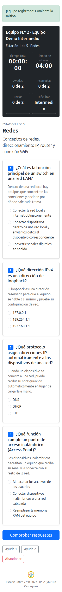

### 4.2 Transición 1

- **Ruta:** `/juego/transicion/1`
- **Estado:** estación superada, sin incorrectas y con el tiempo congelado.
- **Siguiente:** **Continuar** hacia la estación 2.

  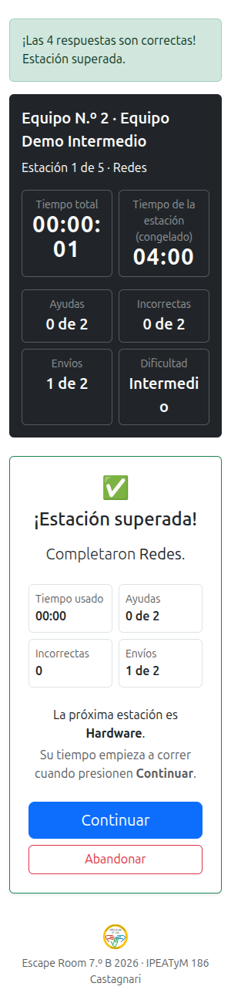

### 4.3 Final del intento

- **Ruta:** `/juego/final`
- **Estado:** intento completo, posición `#1` del nivel Intermedio.
- **Siguiente:** volver al inicio o revisar el ranking.

  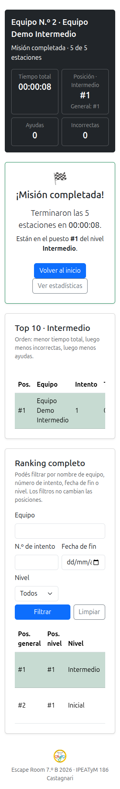

## 5. Recorrido completo · nivel avanzado

Intento `Equipo Demo Avanzado`, dificultad `avanzado`, 3 integrantes. Sin
ayudas ni incorrectas: **00:00:03**.

### 5.1 Estación 1 · Redes

- **Ruta:** `/juego/estacion/1`
- **Estado:** nivel avanzado, con descripción de contexto en cada pregunta.
- **Siguiente:** responder las cuatro preguntas y recorrer las cinco
  estaciones.

  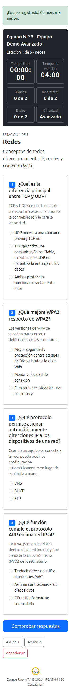

### 5.2 Final del intento

- **Ruta:** `/juego/final`
- **Estado:** intento completo, posición `#1` del nivel Avanzado.
- **Siguiente:** volver al inicio o revisar el ranking.

  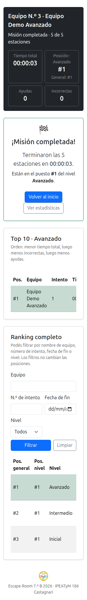

## 6. Intentos no completados

Solo los intentos con `finalizado = 'completo'` participan del ranking
competitivo. Los tres casos siguientes quedan fuera.

### 6.1 Por respuestas incorrectas

Intento `Equipo Demo Incorrectas`, nivel `inicial`.

- **Ruta:** `/juego/estacion/1`
- **Estado:** primer envío con una incorrecta. El HUD muestra **Incorrectas 1
  de 2** y **Envíos 1 de 2**, y un aviso con los envíos realizados.
- **Siguiente:** corregir y volver a enviar; si se acumulan 2 incorrectas, el
  intento se cierra.

  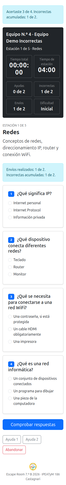

- **Ruta:** `/juego/eliminado`
- **Estado:** el segundo envío también tuvo una incorrecta; el intento se
  cerró como `por_respuestas_incorrectas`.
- **Siguiente:** volver al inicio o ver el ranking. El intento no se reanuda.

  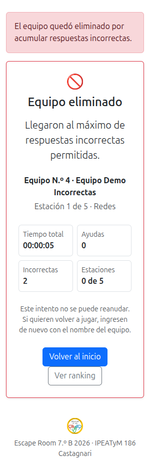

### 6.2 Por abandono

Intento `Equipo Demo Abandono`, nivel `intermedio`.

- **Ruta:** `/juego/estacion/1`
- **Acción:** el botón **Abandonar** abre el diálogo nativo
  «¿Abandonar el juego? El intento quedará cerrado.». Al aceptar, el intento se
  cierra como `abandono`.
- **Ruta resultante:** `/juego/eliminado`
- **Estado:** la pantalla explica que el equipo abandonó el juego.
- **Siguiente:** volver al inicio o ver el ranking.

  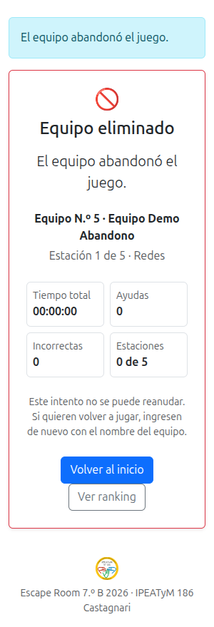

### 6.3 Por tiempo agotado

Intento `Equipo Demo Tiempo`, nivel `avanzado`. La estación dura 4 minutos; al
llegar a cero, el servidor cierra el intento como `por_tiempo`.

- **Ruta:** `/juego/eliminado`
- **Estado:** el tiempo de la estación se agotó y el intento no se puede
  reanudar.
- **Siguiente:** volver al inicio o ver el ranking.

  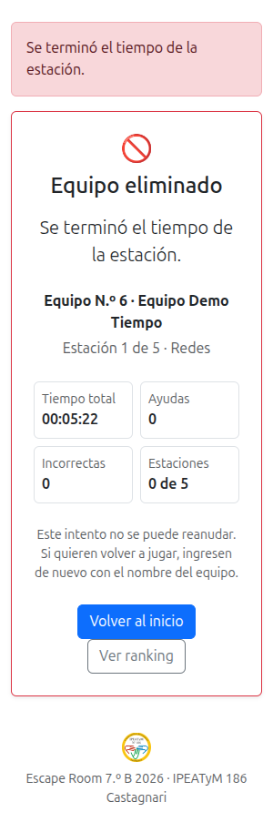

## 7. Estados especiales

### 7.1 Aviso de los 30 segundos

- **Ruta:** `/juego/estacion/1`
- **Estado:** quedan 30 segundos o menos. El contador de la estación se muestra
  en rojo y aparece el texto titilante **¡Quedan 30 segundos!**. En la app real
  también suena un audio de aviso; si el navegador lo bloquea, la advertencia
  visual se muestra igual.
- **Siguiente:** responder antes de que llegue a cero o el intento se cierra.

  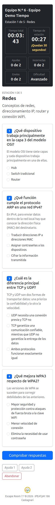

> En la captura se congeló la animación desde la consola del navegador para que
> el texto se vea en la foto. No es un cambio en la app.

### 7.2 Modo «solo finalizar»

Con la configuración de la feria (`max_envios_estacion = 2` y
`max_respuestas_incorrectas = 2`), este estado no se alcanza en una partida
normal: el segundo envío con una incorrecta llega antes a la eliminación. Para
la captura se bajó temporalmente el máximo de envíos a 1 en la base de
capturas y se restauró después.

- **Ruta:** `/juego/estacion/1`
- **Estado:** el único envío tuvo una incorrecta y ya no quedan envíos. Se
  ocultan el formulario, las ayudas y el abandono; queda solo **Finalizar
  juego**.
- **Siguiente:** presionar **Finalizar juego** y aceptar la confirmación. El
  intento se cierra como `por_respuestas_incorrectas`.

  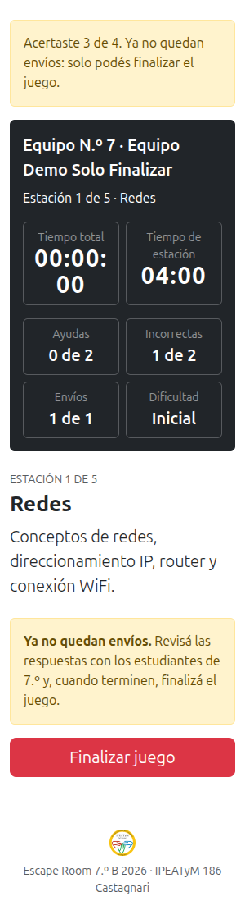

### 7.3 Estación no disponible

Si una estación no tiene al menos 4 preguntas activas del nivel elegido (o
falta cobertura en algún tema), el servidor responde **503** al intentar
entrar. No crea filas parciales y no deja jugar.

- **Ruta:** `/juego/estacion/1`
- **Estado:** cobertura insuficiente en la estación 1 para el nivel inicial.
- **Siguiente:** avisar a la organización; se corrige la cobertura desde el
  panel de administración.

  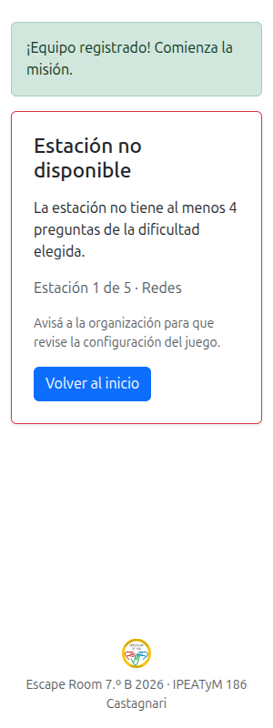

### 7.4 Solicitud no válida

Un `POST` sin el token CSRF se rechaza con **400** antes de ejecutar la ruta.
No crea filas ni modifica datos.

- **Ruta:** `POST /juego/estacion/1/responder` sin token.
- **Estado:** la app pide volver a cargar la página e intentar de nuevo.
- **Siguiente:** recargar y enviar desde el formulario real.

  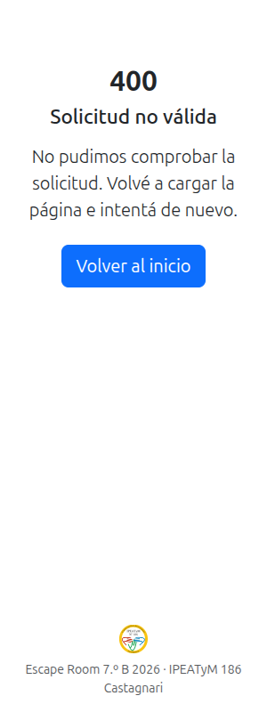

### 7.5 Reanudación

No tiene una pantalla propia:

- Recargar una estación mantiene las mismas 4 preguntas (la selección está
  congelada en `intento_pregunta`) y los mismos tiempos (se calculan desde las
  fechas de MySQL).
- Salir y volver a entrar con el mismo nombre deriva a `/equipo/identificar`.
- Con un intento activo, `GET /` muestra el formulario con un aviso y el botón
  **Continuar**, sin redirección automática.

## 8. Administración

El panel exige login y no está enlazado desde ninguna página pública. Para las
capturas se usaron credenciales temporales por variables de entorno, nunca las
reales; no se guardaron en el repositorio ni se transcriben acá.

### 8.1 Login

- **Ruta:** `/admin` sin sesión
- **Estado:** usuario y clave. Un error devuelve un mensaje genérico.
- **Siguiente:** ingresar para abrir el panel.

  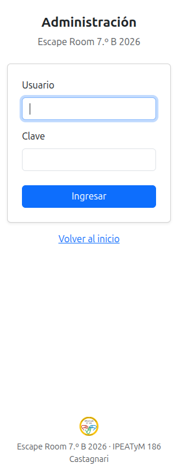

### 8.2 Panel de control

- **Ruta:** `/admin/`
- **Estado:** estado del juego, accesos a cobertura, dificultades, intentos
  activos y estadísticas, y cards de las 12 tablas separadas en contenido e
  historial.
- **Siguiente:** abrir una sección o un listado.

  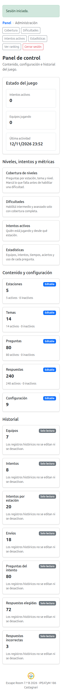

### 8.3 Listado de preguntas

- **Ruta:** `/admin/pregunta`
- **Estado:** listado paginado con buscador, filtros por estado y dificultad, y
  acciones de edición y baja lógica.
- **Siguiente:** abrir una pregunta, editarla o crear una nueva.

  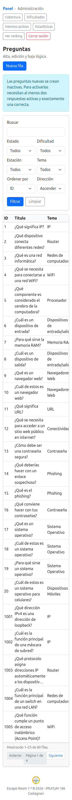

### 8.4 Alta de pregunta

- **Ruta:** `/admin/pregunta/nuevo`
- **Estado:** formulario de alta. Las preguntas nuevas se guardan inactivas y
  necesitan al menos dos respuestas activas y exactamente una correcta para
  poder activarse.
- **Siguiente:** completar y guardar, o cancelar.

  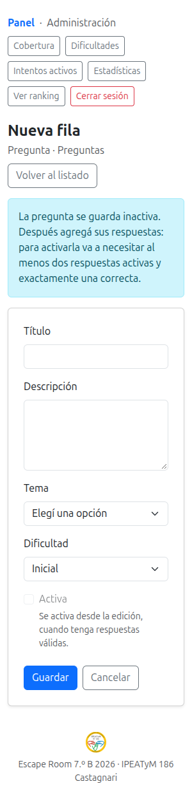

### 8.5 Detalle de pregunta

- **Ruta:** `/admin/pregunta/<id>`
- **Estado:** detalle de una pregunta usada en los intentos, con sus respuestas
  y metadatos.
- **Siguiente:** editar o volver al listado.

  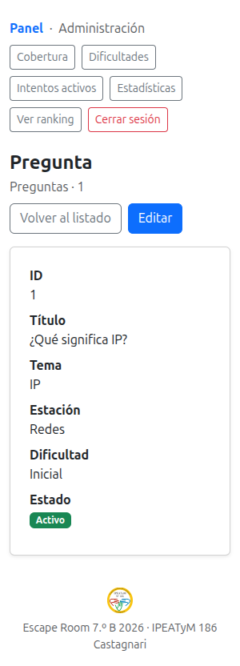

### 8.6 Edición de pregunta

- **Ruta:** `/admin/pregunta/<id>/editar`
- **Estado:** formulario de edición. Cambiar la respuesta correcta no altera
  los intentos ya finalizados.
- **Siguiente:** guardar o cancelar.

  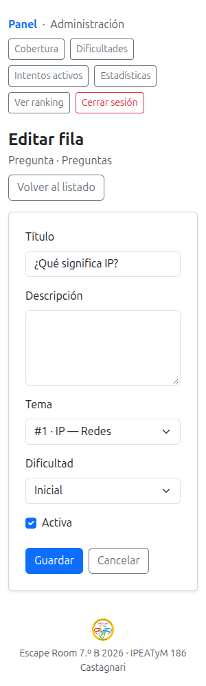

### 8.7 Cobertura

- **Ruta:** `/admin/cobertura`
- **Estado:** reporte estación × nivel con temas activos, preguntas por tema,
  total y estado. Los tres niveles figuran completos.
- **Siguiente:** usar **Administrar dificultades** para habilitar o deshabilitar
  intermedio y avanzado.

  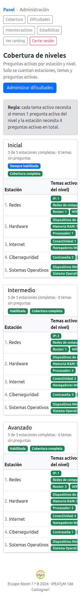

### 8.8 Dificultades

- **Ruta:** `/admin/dificultades`
- **Estado:** sin intentos activos. `inicial` siempre está habilitada;
  `intermedio` y `avanzado` se pueden cambiar porque tienen cobertura completa.
- **Siguiente:** guardar los cambios.

  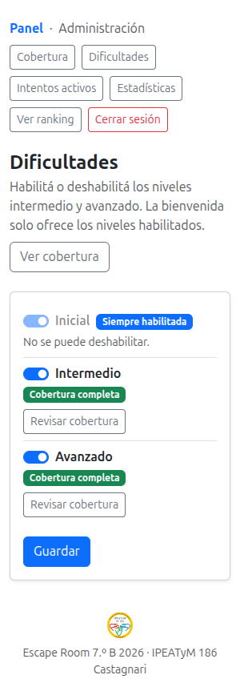

- **Ruta:** `/admin/dificultades`
- **Estado:** con un intento activo. Los toggles quedan bloqueados hasta que
  terminen todos los equipos.
- **Siguiente:** esperar a que terminen los intentos activos.

  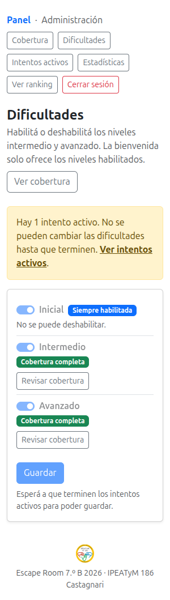

### 8.9 Intentos activos

- **Ruta:** `/admin/intentos-activos`
- **Estado:** equipo, intento, dificultad, estación actual, tiempo transcurrido
  y última actividad del equipo que está jugando.
- **Siguiente:** actualizar o abrir dificultades.

  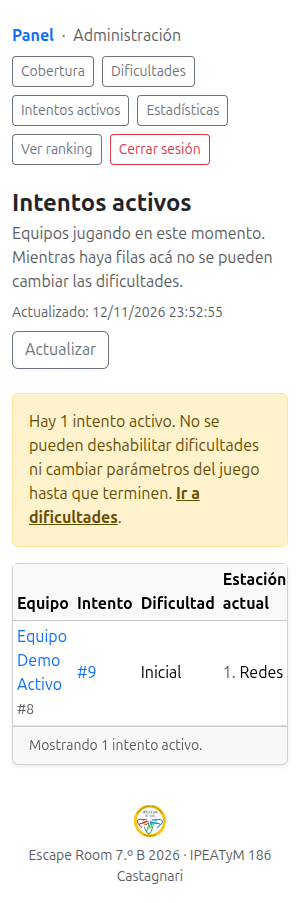

### 8.10 Estadísticas del admin

- **Ruta:** `/admin/estadisticas`
- **Estado:** filtros por fecha y dificultad, indicadores, intentos por estado
  (incluye **En curso**), tiempo promedio por estación, utilización de cada
  pregunta y porcentaje de aciertos. Las barras se generan en el servidor.
- **Siguiente:** filtrar o limpiar los filtros.

  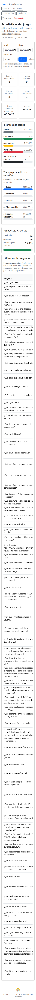

## 9. Pantallas de error

### 9.1 Página no encontrada

- **Ruta:** `/ruta-inexistente`
- **Estado:** **404** con un mensaje amigable y un enlace para volver al
  inicio.
- **Siguiente:** volver al inicio.

  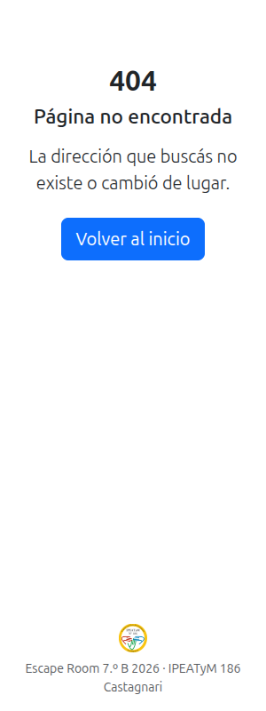

La página **500** no se captura: exigiría romper la app a propósito.

## 10. Resumen de rutas y estados

| # | Ruta | Pantalla | Capturas |
| --- | --- | --- | --- |
| 1 | `/` | Bienvenida | `00`, `01` |
| 2 | `/equipo/identificar` | Identificación de equipo | `02` |
| 3 | `/juego` | Redirección a la estación actual | — |
| 4 | `/juego/estacion/<orden>` | Estación | `10`–`14`, `18`, `20`, `30`, `40`, `50`, `51`, `52` |
| 5 | `/juego/estacion/<orden>/responder` | Envío | Sin pantalla propia |
| 6 | `/juego/estacion/<orden>/ayuda` | Ayuda | Estado en `18` |
| 7 | `/juego/estacion/<orden>/abandonar` | Confirmación de abandono | Diálogo nativo, resultado en `42` |
| 8 | `/juego/estacion/<orden>/finalizar` | Cierre por respuestas incorrectas | Resultado en `41` |
| 9 | `/juego/transicion/<orden>` | Transición | `15`, `16`, `21` |
| 10 | `/juego/final` | Final | `17`, `22`, `31` |
| 11 | `/juego/eliminado` | Eliminación | `41`, `42`, `43` |
| 12 | `/juego/estado` | JSON de tiempos | — |
| 13 | `/ranking` | Ranking público | `03`, `05`, `91` |
| 14 | `/ranking/datos` | JSON del ranking | — |
| 15 | `/estadisticas` | Estadísticas públicas | `04` |
| 16 | `/admin` | Login | `60` |
| 17 | `/admin/login` | Validación de login | Sin pantalla propia |
| 18 | `/admin/logout` | Cierre de sesión | Sin pantalla propia |
| 19 | `/admin/` | Panel | `61` |
| 20 | `/admin/<tabla>` | Listado | `62` |
| 21 | `/admin/<tabla>/nuevo` | Alta | `63` |
| 22 | `/admin/<tabla>/<id>` | Detalle | `64` |
| 23 | `/admin/<tabla>/<id>/editar` | Edición | `65` |
| 24 | `/admin/<tabla>/<id>/desactivar` | Baja lógica | Sin pantalla propia |
| 25 | `/admin/cobertura` | Cobertura | `66` |
| 26 | `/admin/dificultades` | Dificultades | `67`, `68` |
| 27 | `/admin/intentos-activos` | Intentos activos | `69` |
| 28 | `/admin/estadisticas` | Estadísticas del admin | `70` |
| 29 | `/salud` | Salud | — |
| 30 | — | 400 | `53` |
| 31 | — | 404 | `90` |
| 32 | — | 503 | `52` |

## 11. Cómo se generaron las capturas

1. Se creó una base **descartable** `escape_room_7b2026_capturas` a partir de
   `bd/escape_room_7b2026_completa.sql`, con el nombre reemplazado en una copia
   fuera del repositorio. La base real `escape_room_7b2026` no se tocó.
2. Se levantó la app en el puerto **5056** con `MYSQL_DB` apuntando a la base de
   capturas y credenciales de administración temporales por variables de
   entorno. No se editó el `.env`.
3. Se abrió Chrome con `chrome-devtools`, se emuló
   `300x800x1,mobile,touch` y se verificó `innerWidth = 300` y ausencia de
   desborde horizontal antes de empezar.
4. Se ejecutaron los intentos A a G con el flujo real: formularios, envíos,
   ayudas, abandono y finalización. Las respuestas correctas se leyeron por SQL
   **solo en la base de capturas** para poder enviar el formulario; no se
   transcribieron al documento.
5. Los estados de tiempo se provocaron adelantando o atrasando el inicio de la
   estación en la base de capturas. No se cambió la duración configurada.
6. Para el 503 se desactivó temporalmente una pregunta de la estación 1 y se
   restauró al terminar. Para el modo «solo finalizar» se bajó temporalmente el
   máximo de envíos a 1 y se restauró.
7. Al finalizar se detuvo el servidor, se eliminó la base de capturas y se
   borró la copia temporal del SQL. La carpeta `app/`, las pruebas y los seeds
   no se modificaron.

Las capturas se generaron el **12/11/2026** con la app en el estado del
`paso11e`. Los equipos y los tiempos son de prueba.
