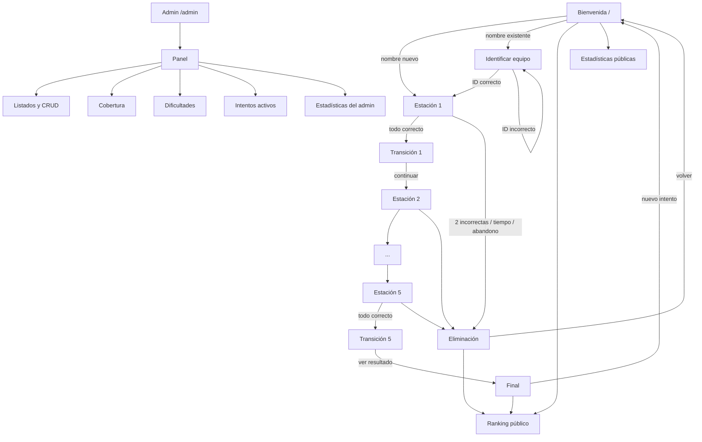

# Navegación por la aplicación

Mapa de pantallas, elementos y objetivos de la app del **Escape Room 7.º B 2026**.

> Estado: la aplicación Flask **ya está implementada**. Este documento describe
> la navegación real y sirve como mapa de pantallas y rutas. Si el código
> adopta otra ruta, actualizar este archivo junto con el cambio.

Fuentes de verdad:

- `docs/escape-room.md` — requisitos funcionales.
- `AGENTS.md` — decisiones registradas y reglas del juego.
- `sql/descripcion-de-la-base-de-datos.md` — modelo de datos.

Complemento visual: `docs/navegacion-capturas.md` recorre estas mismas
pantallas con capturas en tamaño móvil, incluyendo intentos completos y no
completados.

---

## 1. Mapa de rutas

| # | Ruta | Método | Pantalla | Acceso | Objetivo |
| --- | --- | --- | --- | --- | --- |
| 1 | `/` | GET | Bienvenida | Público | Pedir nombre de equipo, cantidad de integrantes y dificultad. |
| 2 | `/` | POST | Bienvenida (validación) | Público | Crear equipo e intento, o derivar a identificación. |
| 3 | `/equipo/identificar` | GET/POST | Identificación de equipo | Público | Pedir el ID cuando el nombre ya existe. |
| 4 | `/juego` | GET | Redirección al juego | Sesión de intento | Llevar al intento activo o a la bienvenida. |
| 5 | `/juego/estacion/<orden>` | GET | Estación | Sesión de intento | Mostrar las 4 preguntas, el HUD y los temporizadores. |
| 6 | `/juego/estacion/<orden>/responder` | POST | Estación (envío) | Sesión de intento | Validar el envío y registrar respuestas. |
| 7 | `/juego/estacion/<orden>/ayuda` | POST | Estación (ayuda) | Sesión de intento | Registrar una ayuda. |
| 8 | `/juego/estacion/<orden>/abandonar` | POST | Confirmación de abandono | Sesión de intento | Cerrar el intento como `abandono`. |
| 9 | `/juego/transicion/<orden>` | GET | Transición | Sesión de intento | Confirmar estación superada y permitir continuar. |
| 10 | `/juego/final` | GET | Final | Sesión de intento | Mostrar resultado del intento y ranking. |
| 11 | `/juego/eliminado` | GET | Eliminación | Sesión de intento | Explicar por qué el equipo quedó fuera. |
| 12 | `/ranking` | GET | Ranking público | Público | Vista de solo lectura para el televisor. |
| 13 | `/ranking/datos` | GET | Ranking (JSON) | Público | Datos para el polling de la vista de TV. |
| 14 | `/estadisticas` | GET | Estadísticas públicas | Público | Mostrar agregados sin datos sensibles. |
| 15 | `/admin` | GET | Login de administración | Público | Formulario de usuario y clave. |
| 16 | `/admin/login` | POST | Login (validación) | Público | Iniciar sesión de admin. |
| 17 | `/admin/logout` | POST | Cierre de sesión | Admin | Cerrar la sesión. |
| 18 | `/admin/` | GET | Panel de control | Admin | Cards por tabla, estado del juego y accesos. |
| 19 | `/admin/<tabla>` | GET | Listado | Admin | Listar filas con filtros y orden. |
| 20 | `/admin/<tabla>/nuevo` | GET/POST | Alta | Admin | Crear una fila. |
| 21 | `/admin/<tabla>/<id>/editar` | GET/POST | Edición | Admin | Editar una fila. |
| 22 | `/admin/<tabla>/<id>/desactivar` | POST | Baja lógica | Admin | Poner `activo = 0` en contenido. |
| 23 | `/admin/cobertura` | GET | Cobertura | Admin | Reporte estación × nivel con faltantes en rojo. |
| 24 | `/admin/dificultades` | GET/POST | Dificultades | Admin | Habilitar o deshabilitar niveles. |
| 25 | `/admin/intentos-activos` | GET | Intentos activos | Admin | Ver equipos jugando y bloquear toggles. |
| 26 | `/admin/estadisticas` | GET | Estadísticas del admin | Admin | Gráficos y métricas completas. |
| 27 | `/salud` | GET | Salud | Público | Confirmar que la app y MySQL responden. |
| 28 | — | — | 404 / 500 | Público | Errores amigables con enlace a la bienvenida. |

Notas:

- `/admin` **no se enlaza** desde ninguna pantalla pública.
- Las rutas de juego requieren una sesión de intento válida. Sin sesión redirigen a `/`.
- `orden` va de 1 a 5 y se valida contra `estacion.orden`, no contra el `id`.

---

## 2. Estructura visual común

Todas las pantallas usan una plantilla base (`templates/base.html`) con:

- Bootstrap local desde `static/vendor/` (sin CDN).
- Tipografía grande y botones amplios, pensados para usarse de pie y a distancia.
- Un bloque de mensajes flash para errores y confirmaciones.
- Un pie discreto con el logo de la escuela, el nombre institucional y sin enlaces de administración.

### HUD del intento

Presente en **todas** las pantallas del juego (estación, transición, final y eliminación):

| Elemento | Contenido | Regla |
| --- | --- | --- |
| Equipo | `Equipo N.º <id> · <nombre>` | Visible siempre. |
| Estación actual | `Estación 2 de 5 · Hardware` | Según `estacion.orden`. |
| Tiempo general | `03:41` ascendente | Calculado desde `intento.fecha_inicio` y mostrado como `MM:SS`, igual que el de estación. |
| Tiempo de estación | `02:19` descendente | Calculado desde `intento_estacion.fecha_inicio`. |
| Ayudas | `Ayudas: 1 de 2` | Según `intento_estacion.ayudas`. |
| Respuestas incorrectas | `Incorrectas: 1 de 2` | Según las filas de `incorrecta` de la estación. |
| Envíos | `Envíos: 1 de 2` | Según `intento_envio` de la estación. |

El HUD se alimenta del servidor. El JavaScript solo dibuja la cuenta regresiva entre sincronizaciones; no decide estados ni validaciones.

---

## 3. Pantallas del juego

### 3.1 Bienvenida (`/`)

**Objetivo:** identificar al equipo y abrir (o reanudar) un intento.

Elementos:

- Logo del IPEATyM 186 Castagnari arriba del título.
- Título y bajada de la feria.
- Foto del frente del edificio entre el encabezado y el formulario.
- Campo **Nombre del equipo** (obligatorio, máximo 120 caracteres).
- Selector **Cantidad de integrantes** (1 a 4, obligatorio).
- Selector **Dificultad** con solo las opciones habilitadas en `configuracion`. `inicial` siempre está; `intermedio` y `avanzado` aparecen solo si están habilitadas.
- Botón **Iniciar misión**.
- Texto de ayuda: "Si tu equipo ya jugó, vas a necesitar el ID que te dimos".
- Enlace a `/ranking` y `/estadisticas` (públicos).

Comportamiento:

- Nombre vacío o cantidad fuera de 1–4: error en el mismo formulario, sin crear nada.
- Nombre nuevo: crea `equipo` e `intento` y entra a la estación 1.
- Nombre existente: redirige a **Identificación de equipo** y no crea un equipo nuevo.
- Si el equipo tiene un intento con `fecha_fin IS NULL`, se reanuda desde `ultima_estacion_visitada`.
- Si el intento anterior terminó, se crea uno nuevo con la dificultad elegida.

Estados especiales:

- Sin dificultades cargadas o sin cobertura: mensaje de error de configuración y enlace a `/admin` solo para quien conozca la ruta.
- Si hay un intento activo en la sesión, se muestra un aviso con la opción de continuar o abandonarlo.

### 3.2 Identificación de equipo (`/equipo/identificar`)

**Objetivo:** confirmar que quien reingresa es el mismo equipo cuando el nombre ya existe.

Elementos:

- Nombre ingresado (solo lectura).
- Campo **ID del equipo** (numérico).
- Botón **Continuar**.
- Botón **Volver** a la bienvenida.
- Recordatorio: "El ID se muestra en el HUD, arriba a la derecha".

Comportamiento:

- Si el ID no existe o no coincide con el nombre, error y nuevo intento.
- Si coincide y hay intento activo, se reanuda.
- Si coincide y no hay intento activo, se crea uno nuevo.
- No se permite crear un segundo equipo con el mismo nombre.

### 3.3 Estación (`/juego/estacion/<orden>`)

**Objetivo:** resolver las 4 preguntas de la estación dentro del tiempo.

Elementos:

- HUD completo.
- Título de la estación y número (`Estación 3 de 5 · Internet`).
- Texto breve de la estación (`estacion.descripcion`).
- Las **4 preguntas** en tarjetas, cada una con su descripción breve
  (`pregunta.descripcion`) debajo del enunciado cuando el nivel la tiene, y
  sus 3 opciones como radios.
- Botón **Comprobar respuestas**.
- Botones **Ayuda 1** y **Ayuda 2** con confirmación; se deshabilitan al llegar a 2.
- Botón **Abandonar** con confirmación.
- Zona de mensajes: aciertos del envío, incorrectas acumuladas, aviso de último envío.
- Aviso titilante + audio a los 30 segundos restantes.
- Al llegar a 0: se deshabilita el formulario y se redirige a `/juego/eliminado`.

Reglas visibles:

- Las preguntas no cambian al recargar: salen de `intento_pregunta`.
- No se muestra cuál opción es correcta antes de enviar.
- Si el envío tiene todo correcto: pasa a transición.
- Si hay 1 incorrecta: se acumula y queda 1 envío.
- Si hay 2 incorrectas en el intento de la estación: se elimina.
- Con 2 envíos realizados y el segundo sin todo correcto: solo queda **Finalizar juego**.
- No se puede saltar a otra estación escribiendo la URL.

### 3.4 Transición (`/juego/transicion/<orden>`)

**Objetivo:** confirmar que la estación se superó y preparar la siguiente.

Elementos:

- HUD.
- Mensaje **"¡Estación superada!"** con el nombre de la estación.
- Resumen: tiempo usado, ayudas e incorrectas de la estación.
- Anuncio de la próxima estación.
- Botón **Continuar** (o **Ver resultado** si era la quinta).
- Botón **Abandonar** con confirmación.

Comportamiento:

- Si se intenta entrar a una transición que no corresponde, redirige a la estación actual.
- Al continuar, se registra el inicio de la próxima estación en `intento_estacion` y se actualiza `ultima_estacion_visitada`.
- El cronómetro de la próxima estación arranca recién al presionar **Continuar**.

### 3.5 Final (`/juego/final`)

**Objetivo:** mostrar el resultado del intento completado y el ranking.

Elementos:

- Encabezado oscuro con el equipo, la cantidad de estaciones completadas, el tiempo total, la posición dentro de su nivel, la posición general, las ayudas y las incorrectas.
- Mensaje **"¡Misión completada!"**.
- Tiempo total, posición en el nivel y botón **Volver al inicio** para un nuevo intento.
- Card **Top 10** del nivel del intento con posición, equipo, número de intento, tiempo, incorrectas, ayudas y fecha de fin.
- Card **Ranking completo** con posiciones general y de nivel, columna **Nivel** y filtros por nombre de equipo, número de intento, fecha de fin y nivel.
- La fecha de fin se muestra como `dd/mm/aaaa HH:MM`.
- Enlace a `/estadisticas`.

Comportamiento:

- Solo se llega si `finalizado = 'completo'`.
- `puntaje_obtenido` se calcula en el servidor como segundos totales.
- Si el intento está activo, redirige a la estación actual.
- Si el intento no está completo, redirige a `/juego/eliminado`.
- El top 10 es del nivel del intento y no se filtra. Los filtros se aplican solo al ranking completo y no cambian la posición general ni la de nivel de cada fila.

### 3.6 Eliminación (`/juego/eliminado`)

**Objetivo:** explicar con claridad por qué el equipo quedó fuera.

Elementos:

- HUD.
- Ícono y título según la causa.
- Mensaje específico:
  - `por_tiempo`: "Se terminó el tiempo de la estación".
  - `por_respuestas_incorrectas`: "Llegaron a 2 respuestas incorrectas".
  - `abandono`: "El equipo abandonó el juego".
- Resumen: estación alcanzada, tiempo total, ayudas e incorrectas.
- Botón **Volver al inicio**.
- Enlace a `/ranking`.

Comportamiento:

- Se llega por redirección del servidor, nunca por un enlace directo.
- El intento ya tiene `fecha_fin` y `finalizado` distinto de `completo`.
- No se puede reanudar ese intento; el próximo ingreso crea uno nuevo.

---

## 4. Pantallas públicas

### 4.1 Ranking público (`/ranking`)

**Objetivo:** vista permanente para el televisor del aula.

Elementos:

- Logo de la escuela a la izquierda del título **"Ranking Escape Room 7.º B"**.
- Enlaces **Inicio** y **Estadísticas** en la parte superior.
- Una sección y una tabla por nivel, con el nombre del nivel como encabezado: posición, equipo, número de intento, tiempo total, incorrectas, ayudas y fecha de fin.
- Indicador de última actualización.
- Aviso general si todavía no hay intentos completados y aviso por nivel si ese nivel todavía no tiene equipos.
- Sin botones de administración ni datos sensibles.

Comportamiento:

- Solo muestra `finalizado = 'completo'`.
- Orden: tiempo ascendente; en empate, menos incorrectas; luego menos ayudas; luego el intento que comenzó antes; luego `id` ascendente. La posición que se muestra es la del nivel.
- `inicial` se muestra siempre; `intermedio` y `avanzado` se muestran si están habilitados o si ya tienen intentos completados.
- Se actualiza sola cada 5–10 segundos consultando `/ranking/datos`, que devuelve las filas agrupadas por nivel.
- Si el polling falla, mantiene todas las tablas y muestra "Reconectando…" sin borrar datos.
- Tipografía y contraste pensados para leerse a varios metros.

### 4.2 Estadísticas públicas (`/estadisticas`)

**Objetivo:** mostrar el pulso de la feria sin exponer datos personales.

Elementos:

- Enlaces **Inicio** y **Ranking** en la parte superior.
- Cards con: equipos participantes, integrantes totales, intentos iniciados, intentos completados y tiempo promedio de los completados.
- Respuestas realizadas y porcentaje de aciertos.
- Gráfico simple de intentos por estado (completos, abandonos, por tiempo, por incorrectas), con la cantidad total al lado del título y el ancho de cada barra según su porcentaje real.
- Tiempo promedio por estación, con filtro general o por nivel (`inicial`, `intermedio`, `avanzado`). El filtro afecta solo a este cuadro. La barra completa equivale a la duración máxima de una estación (`configuracion.duracion_estacion_segundos`, 4 minutos) y pinta el porcentaje real del promedio.
- Fecha de actualización.

Restricciones:

- Sin nombres de equipos.
- Sin detalle por pregunta.
- Sin respuestas correctas.
- Accesible sin login.

---

## 5. Administración

### 5.1 Login (`/admin`)

**Objetivo:** proteger todo el panel.

Elementos:

- Campo **Usuario**.
- Campo **Clave**.
- Botón **Ingresar**.
- Mensaje de error genérico ("Usuario o clave incorrectos") sin revelar cuál falló.

Comportamiento:

- Credenciales por `ADMIN_USER` y `ADMIN_PASSWORD_HASH`.
- Sesión de Flask con cierre explícito.
- Cualquier ruta `/admin/*` sin sesión redirige al login.
- No hay enlace público a `/admin`.

### 5.2 Panel de control (`/admin/`)

**Objetivo:** punto de entrada a la gestión.

Elementos:

- Cards por tabla: `equipo`, `intento`, `estacion`, `tema`, `pregunta`, `respuesta`, `configuracion`, `intento_estacion`, `intento_envio`, `intento_pregunta`, `respuesta_elegida`, `incorrecta`.
- En cada card: cantidad de filas, activos/inactivos cuando aplica y acceso al listado.
- Estado del juego: intentos activos, equipos jugando, última actividad.
- Accesos directos a **Cobertura**, **Dificultades**, **Estadísticas** e **Intentos activos**.
- Botón **Cerrar sesión**.

### 5.3 Listados (`/admin/<tabla>`)

**Objetivo:** encontrar y operar filas.

Elementos:

- Tabla con columnas relevantes por entidad.
- Filtros: activo/inactivo, dificultad, estación, tema, fechas, texto libre.
- Ordenamiento por `id` y por nombre, dificultad, orden o fecha según la tabla.
- Paginación.
- Acciones: **Ver**, **Editar**, **Desactivar** (contenido) o **Bloqueado** (históricos).

Reglas:

- `equipo`, `intento`, `respuesta_elegida` e `incorrecta` no se borran ni se desactivan.
- `estacion`, `tema`, `pregunta` y `respuesta` usan baja lógica.
- Los listados muestran activos e inactivos con un filtro claro.

### 5.4 Alta y edición (`/admin/<tabla>/nuevo`, `/admin/<tabla>/<id>/editar`)

**Objetivo:** cargar y corregir contenido.

Elementos:

- Formulario con los campos de la tabla.
- Validaciones en el servidor:
  - `equipo.nombre` único y `cantidad_personas` entre 1 y 4.
  - `estacion.orden` único y de 1 a 5.
  - máximo 4 temas activos por estación.
  - `pregunta.dificultad` válida.
  - exactamente una respuesta correcta por pregunta.
- Mensajes de error junto al campo.
- Botón **Guardar** y **Cancelar**.

Reglas:

- Cambiar la respuesta correcta de una pregunta **no** altera intentos ya finalizados.
- No se puede eliminar físicamente contenido ni históricos.
- Los formularios de históricos son de solo lectura.

### 5.5 Cobertura (`/admin/cobertura`)

**Objetivo:** saber si un nivel se puede habilitar.

Elementos:

- Tabla estación × nivel con:
  - temas activos,
  - preguntas por tema,
  - total de preguntas,
  - estado (verde/rojo).
- Leyenda: "Al menos 1 pregunta por tema y 4 en total".
- Enlace a las preguntas faltantes.

Comportamiento:

- Marca en rojo todo tema sin pregunta del nivel y toda estación con menos de 4.
- `inicial` se muestra siempre como habilitada.

### 5.6 Dificultades (`/admin/dificultades`)

**Objetivo:** habilitar o deshabilitar `intermedio` y `avanzado`.

Elementos:

- Dos toggles con su estado actual.
- Cobertura resumida de cada nivel.
- Cantidad de intentos activos.
- Botón **Guardar**.

Comportamiento:

- No se puede habilitar un nivel sin cobertura completa en todas las estaciones.
- No se puede deshabilitar un nivel si hay intentos activos (`fecha_fin IS NULL`).
- Los cambios se guardan en `configuracion`.
- `inicial` no se puede deshabilitar.

### 5.7 Intentos activos (`/admin/intentos-activos`)

**Objetivo:** ver quién está jugando y por qué se bloquean los toggles.

Elementos:

- Tabla con equipo, intento, dificultad, estación actual, tiempo transcurrido y última actividad.
- Botón **Actualizar**.
- Aviso de que mientras haya filas acá no se pueden deshabilitar dificultades.

### 5.8 Estadísticas del admin (`/admin/estadisticas`)

**Objetivo:** analizar el uso real del juego.

Elementos:

- Gráficos con barras CSS generadas en el servidor:
  - equipos participantes,
  - intentos finalizados,
  - tiempo promedio por estación,
  - tiempo promedio de intentos completados,
  - porcentaje de utilización de cada pregunta sobre el total de intentos,
  - porcentaje de aciertos.
- Filtros por fecha y dificultad.
- Tabla exportable (opcional).

---

## 6. Flujo de navegación

Reglas del flujo:

- No se puede llegar a una estación sin pasar por la anterior.
- No se puede volver a una estación ya completada.
- Recargar cualquier pantalla del juego no reinicia tiempos ni cambia preguntas.
- El botón **Atrás** del navegador no debe permitir reenviar un formulario ya procesado: usar POST + redirección (patrón PRG).
- El abandono siempre pide confirmación.
- El cierre de sesión del admin es POST, no un enlace GET.

---

## 7. Mensajes y estados

| Situación | Dónde se muestra | Texto sugerido |
| --- | --- | --- |
| Nombre vacío | Bienvenida | "Ingresá el nombre del equipo". |
| Cantidad inválida | Bienvenida | "La cantidad de integrantes debe ser entre 1 y 4". |
| Nombre existente | Bienvenida | "Ese equipo ya existe. Ingresá el ID para continuar". |
| ID incorrecto | Identificación | "El ID no coincide con el equipo". |
| Dificultad no habilitada | Bienvenida | "Esa dificultad todavía no está disponible". |
| Estación fuera de orden | Juego | "Primero tenés que completar la estación anterior". |
| Tiempo agotado | Estación | "Se terminó el tiempo de esta estación". |
| 2 incorrectas | Estación | "Llegaron a 2 respuestas incorrectas". |
| Último envío | Estación | "Este es el último envío: si no está todo correcto, el juego termina". |
| 30 segundos | Estación | "¡Quedan 30 segundos!" (titilante + audio). |
| Sin intentos completados | Ranking | "Todavía no hay equipos que hayan completado el recorrido". |
| Sin conexión en TV | Ranking | "Reconectando..." sin borrar la tabla. |
| Sin sesión de admin | Admin | Redirección al login. |
| Cobertura incompleta | Admin | "Faltan preguntas para habilitar este nivel". |
| Intento activo | Admin | "No se puede cambiar la dificultad mientras hay equipos jugando". |

---

## 8. Accesibilidad y uso en la feria

- Contraste alto y tipografía grande en el HUD y el ranking.
- Botones con área de toque amplia; nada esencial depende de `hover`.
- El audio de los 30 segundos se desbloquea con la primera interacción (botón **Iniciar misión**).
- El aviso de los 30 segundos es **visual y sonoro**; si el navegador bloquea el audio, el texto titilante sigue funcionando.
- Navegación por teclado en formularios y foco visible.
- El ranking no depende de Internet: Bootstrap, JS y audio son locales.
- El televisor usa `/ranking` en pantalla completa y sin cursor.

---

## 9. Lo que la navegación no debe permitir

- Enlazar `/admin` desde cualquier pantalla pública.
- Mostrar respuestas correctas en el HTML o en el JavaScript.
- Cambiar preguntas al recargar.
- Saltar estaciones por URL.
- Reanudar un intento ya finalizado.
- Crear un equipo duplicado cuando el nombre ya existe.
- Mostrar nombres de equipos o detalle por pregunta en `/estadisticas`.
- Deshabilitar una dificultad con intentos activos.
- Borrar físicamente contenido o históricos.
