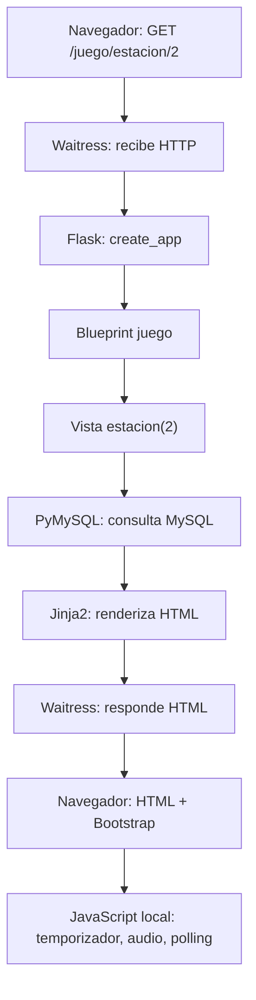

# Tecnologías del proyecto

Introducción al stack con el que se construye la aplicación de **Escape Room 7.º B 2026** del IPEATyM 186 Castagnari.

> Estado: la aplicación Flask **todavía no está implementada**. Este documento describe las tecnologías **previstas** para el scaffold. Los requisitos funcionales siguen en `docs/escape-room.md`, que tiene prioridad sobre cualquier otro documento.

## Contenido

- [1. Cómo leer este documento](#1-cómo-leer-este-documento)
- [2. Resumen del stack](#2-resumen-del-stack)
- [3. Conceptos transversales](#3-conceptos-transversales)
  - [3.1 Scaffold](#31-scaffold)
  - [3.2 App factory](#32-app-factory)
  - [3.3 Blueprints y rutas](#33-blueprints-y-rutas)
  - [3.4 WSGI y servidores](#34-wsgi-y-servidores)
  - [3.5 Pruebas con pytest](#35-pruebas-con-pytest)
- [4. Frontend](#4-frontend)
  - [4.1 HTML](#41-html)
  - [4.2 CSS](#42-css)
  - [4.3 JavaScript](#43-javascript)
  - [4.4 Jinja2](#44-jinja2)
  - [4.5 Bootstrap](#45-bootstrap)
  - [4.6 Chart.js](#46-chartjs)
- [5. Backend](#5-backend)
  - [5.1 Python 3](#51-python-3)
  - [5.2 Flask](#52-flask)
  - [5.3 PyMySQL](#53-pymysql)
  - [5.4 python-dotenv](#54-python-dotenv)
  - [5.5 Werkzeug](#55-werkzeug)
- [6. Base de datos](#6-base-de-datos)
  - [6.1 MySQL 8](#61-mysql-8)
  - [6.2 SQL, transacciones e índices](#62-sql-transacciones-e-índices)
  - [6.3 Seed idempotente](#63-seed-idempotente)
  - [6.4 Herramientas de administración](#64-herramientas-de-administración)
- [7. Entorno y ejecución](#7-entorno-y-ejecución)
- [8. Recorrido de una petición](#8-recorrido-de-una-petición)
- [9. Glosario](#9-glosario)
- [10. Lo que no se usa](#10-lo-que-no-se-usa)
- [11. Para seguir leyendo](#11-para-seguir-leyendo)

---

## 1. Cómo leer este documento

Hay que distinguir dos cosas:

- **El stack** es lo que la aplicación usa cuando está funcionando: Python, Flask, Jinja2, MySQL, PyMySQL, HTML, CSS, JavaScript, Bootstrap y Chart.js.
- **Las herramientas** son lo que se usa para desarrollarla, probarla o administrarla: `venv`, `pip`, `pytest`, `waitress`, Git, MySQL Workbench, phpMyAdmin o el cliente `mysql`.

Las herramientas no forman parte del código de la app. Se pueden cambiar sin tocar el juego.

Cada tecnología se explica con la misma estructura:

1. **Qué es.**
2. **Para qué se usa en este proyecto.**
3. **Un ejemplo mínimo.**
4. **Qué evitar o qué no confundir.**

---

## 2. Resumen del stack

| Capa | Tecnología | Para qué se usa | Dónde aparece |
| --- | --- | --- | --- |
| Lenguaje | Python 3 | Toda la lógica del juego, la administración y el acceso a datos. | `app/` |
| Backend | Flask | Rutas, sesiones, validaciones y orquestación del juego. | `app/__init__.py`, `app/routes/` |
| Organización | App factory + blueprints | Crear la app por función y agrupar rutas por dominio. | `app/__init__.py`, `app/routes/` |
| Plantillas | Jinja2 | HTML generado en el servidor, una página por estación. | `templates/` |
| Estructura | HTML | Contenido y semántica de cada pantalla. | `templates/` |
| Estilos | CSS + Bootstrap local | Presentación, componentes y diseño responsive. | `static/css/`, `static/vendor/` |
| Interacción | JavaScript local | Temporizadores visuales, audio, polling y confirmaciones. | `static/js/` |
| Gráficos | Chart.js local | Cards y gráficos del panel de administración. | `static/vendor/` |
| Base de datos | MySQL 8 (InnoDB, `utf8mb4_unicode_ci`) | Equipos, intentos, contenido, envíos y respuestas. | `bd/schema.sql` |
| Driver | PyMySQL | Conexión a MySQL con SQL parametrizado y transacciones. | `app/db.py` |
| Configuración | python-dotenv + `.env` | Credenciales y parámetros fuera del código. | `.env.example`, `app/__init__.py` |
| Hash de claves | Werkzeug | Generar y verificar el hash del admin. | `app/routes/admin.py` |
| Servidor de la feria | waitress | Levantar la app en el aula sin el servidor de desarrollo. | Comando de arranque |
| Pruebas | pytest | Cubrir las reglas críticas del juego y del ranking. | `tests/` |
| Control de versiones | Git | Historial y commits por bloque de trabajo. | Repositorio |

Las versiones exactas se fijan en `requirements.txt` cuando exista el scaffold. Por ahora solo está definido el gestor de base de datos: **MySQL 8**.

---

## 3. Conceptos transversales

### 3.1 Scaffold

**Qué es:** el esqueleto inicial del proyecto. No es un framework ni una tecnología: es la estructura de carpetas y archivos mínimos sobre la que se construye todo lo demás.

**Para qué se usa acá:** para que cada cosa tenga un lugar claro desde el primer día y no terminar con un `app.py` gigante.

```text
app/
  __init__.py          # app factory
  db.py                # conexión a MySQL
  routes/
    juego.py
    ranking.py
    estadisticas.py
    admin.py
  templates/
  static/
    css/
    js/
    audio/
    vendor/
tests/
requirements.txt
.env.example
README.md
```

**Qué evitar:**

- No confundir scaffold con “código provisorio”. Es la base definitiva, aunque al principio tenga rutas vacías.
- No crear carpetas que no se van a usar.
- No copiar el scaffold de otro proyecto sin adaptar la configuración.

En `docs/primeros-pasos.md` el scaffold es el **Pedido 1**.

---

### 3.2 App factory

**Qué es:** una función que crea y configura la aplicación Flask cuando se la llama, en lugar de crear el objeto `app` apenas se importa el módulo.

**Para qué se usa acá:** para poder crear una app con configuración real y otra con configuración de prueba, y para evitar imports circulares entre `app/__init__.py` y las rutas.

```python
# app/__init__.py
from flask import Flask

def create_app(config=None):
    app = Flask(__name__)

    app.config.from_mapping(
        SECRET_KEY="cambiar-en-produccion",
        MYSQL_HOST="localhost",
        MYSQL_DB="escape_room_7b2026",
    )

    if config:
        app.config.update(config)

    from .routes.juego import bp as juego_bp
    from .routes.ranking import bp as ranking_bp
    from .routes.estadisticas import bp as estadisticas_bp
    from .routes.admin import bp as admin_bp

    app.register_blueprint(juego_bp)
    app.register_blueprint(ranking_bp)
    app.register_blueprint(estadisticas_bp)
    app.register_blueprint(admin_bp)

    return app
```

**Qué evitar:**

- No crear `app = Flask(__name__)` en un módulo que después importan las rutas: es la causa típica de imports circulares.
- No leer `.env` ni conectar a MySQL en el momento de importar. Eso se hace dentro de `create_app()` o en un helper.
- No hardcodear credenciales en la función: tienen que venir de `app.config` y de variables de entorno.

---

### 3.3 Blueprints y rutas

**Qué es:** un **blueprint** es un grupo de rutas relacionadas. Una **ruta** es la regla que asocia una URL y un método HTTP con una función de Python.

**Para qué se usa acá:** para separar el juego, el ranking, las estadísticas y el admin en módulos independientes.

```python
# app/routes/juego.py
from flask import Blueprint

bp = Blueprint("juego", __name__, url_prefix="/juego")

@bp.get("/estacion/<int:orden>")
def estacion(orden):
    ...
```

```python
# app/__init__.py
from .routes.juego import bp as juego_bp
app.register_blueprint(juego_bp)
```

Con eso, `GET /juego/estacion/2` llama a `estacion(2)`.

| Blueprint | Prefijo | Responsabilidad |
| --- | --- | --- |
| `juego` | `/juego` | Bienvenida, estaciones, transición, final y abandono. |
| `ranking` | `/ranking` | Ranking público y datos para el televisor. |
| `estadisticas` | `/estadisticas` | Estadísticas públicas. |
| `admin` | `/admin` | Login, panel, CRUD, cobertura y dificultades. |

También se pueden agrupar métodos:

```python
@bp.post("/estacion/<int:orden>/responder")
def responder(orden):
    ...
```

Y generar URLs sin escribirlas a mano:

```python
from flask import url_for

url_for("juego.estacion", orden=2)   # /juego/estacion/2
```

**Qué evitar:**

- No usar `orden` como si fuera el `id` de la estación: el orden va de 1 a 5 y se valida contra `estacion.orden`.
- No confiar en el orden que manda el navegador: el servidor decide qué estación corresponde.
- No meter toda la lógica en la ruta. Las consultas y reglas van en funciones auxiliares o en `db.py`.

---

### 3.4 WSGI y servidores

**Qué es:** WSGI (*Web Server Gateway Interface*) es el estándar de Python que define cómo un servidor web le pasa las peticiones a una aplicación. Flask produce una aplicación WSGI; **waitress** es el servidor que la ejecuta.

**Para qué se usa acá:** para levantar la app en la feria con un servidor estable, no con el servidor de desarrollo de Flask.

| Servidor | Uso | Comando |
| --- | --- | --- |
| Servidor de Flask | Desarrollo local, con recarga automática. | `flask --app app run --debug` |
| Waitress | Aula y feria, sin recarga y con varios hilos. | `waitress-serve --call --listen=0.0.0.0:8000 app:create_app` |

```bash
# Desarrollo
flask --app app run --debug

# Feria: escucha en todas las interfaces para que entren otras notebooks
waitress-serve --call --listen=0.0.0.0:8000 app:create_app
```

- `--call` indica que `app:create_app` es una función que hay que llamar.
- `0.0.0.0` significa “escuchar en todas las interfaces de red”.
- `8000` es el puerto; las otras notebooks entran por `http://IP-de-la-notebook:8000`.

**Qué evitar:**

- No usar `flask run` en la feria: es un servidor de desarrollo y muestra advertencias.
- No usar `debug=True` en producción: expone información interna.
- No confundir waitress con HTTPS. Para una red local escolar no hace falta, pero no hay que exponerlo a Internet.

---

### 3.5 Pruebas con pytest

**Qué es:** el framework de pruebas de Python. Descubre archivos `test_*.py`, ejecuta funciones `test_*` y usa `assert` comunes.

**Para qué se usa acá:** para verificar las reglas que no pueden fallar en la feria: avance, eliminaciones, ranking, ayudas, envíos, selección de preguntas, reingreso y permisos del admin.

```python
# tests/test_reglas.py
def test_avanza_solo_con_las_cuatro_correctas(client):
    respuesta = client.post("/juego/estacion/1/responder", data={
        "pregunta_1": "correcta",
        "pregunta_2": "correcta",
        "pregunta_3": "correcta",
        "pregunta_4": "incorrecta",
    }, follow_redirects=True)

    assert respuesta.status_code == 200
    assert "quedan respuestas incorrectas" in respuesta.get_data(as_text=True)
```

Un fixture prepara la app y la base de prueba:

```python
# tests/conftest.py
import pytest
from app import create_app

@pytest.fixture
def client():
    app = create_app({"TESTING": True, "MYSQL_DB": "escape_room_7b2026_test"})
    with app.test_client() as client:
        yield client
```

Se ejecuta con:

```bash
pytest
```

**Qué evitar:**

- No correr tests contra la base de la feria.
- No depender del orden en que se ejecutan los tests.
- No “arreglar” un test bajando la exigencia: si falla una regla, se corrige el código.

---

## 4. Frontend

### 4.1 HTML

**Qué es:** el lenguaje de estructura de las páginas. Define títulos, párrafos, formularios, tablas y botones.

**Para qué se usa acá:** para la estructura de la bienvenida, las estaciones, el HUD, el ranking y el panel. El HTML se genera en el servidor con Jinja; no es una SPA.

```html
<form method="post" action="{{ url_for('juego.responder', orden=estacion.orden) }}">
  
    <fieldset>
      <legend>{{ pregunta.titulo }}</legend>
      
        <label>
          <input type="radio" name="pregunta_{{ pregunta.id }}" value="{{ opcion.id }}">
          {{ opcion.contenido }}
        </label>
      
    </fieldset>
  

  <button type="submit">Comprobar respuestas</button>
</form>
```

**Qué evitar:**

- No poner la respuesta correcta en un atributo, en un comentario ni en un `data-`.
- No usar HTML para decidir reglas del juego: eso lo hace el servidor.
- No duplicar la estructura de una estación en cinco archivos distintos: se reutiliza una plantilla.

---

### 4.2 CSS

**Qué es:** el lenguaje de presentación. Define colores, tipografía, espaciados y disposición.

**Para qué se usa acá:** para el ajuste fino que Bootstrap no cubre: HUD, colores de estados, texto titilante de los 30 segundos y tipografía grande del ranking.

```css
/* static/css/estilos.css */
.hud {
  display: flex;
  gap: 1rem;
  font-size: 1.25rem;
  font-weight: 600;
}

.aviso-30 {
  color: #b00020;
  animation: titilar 1s steps(2, start) infinite;
}

@keyframes titilar {
  to { visibility: hidden; }
}
```

**Qué evitar:**

- No pelear con Bootstrap: primero se usan sus clases y después se agrega lo mínimo.
- No usar `style=""` en todas las etiquetas: se vuelve imposible de mantener.
- No depender solo del color para indicar un estado; agregar texto o íconos.

---

### 4.3 JavaScript

**Qué es:** el lenguaje que se ejecuta en el navegador. Sirve para cambiar la página sin recargarla.

**Para qué se usa acá:** para dibujar los segundos que bajan, desbloquear el audio, hacer titilar el aviso de los 30 segundos, confirmar ayudas y abandono, y actualizar el ranking con polling.

```javascript
// static/js/ranking.js
async function actualizarRanking() {
  try {
    const respuesta = await fetch("/ranking/datos");
    const datos = await respuesta.json();
    dibujarTabla(datos);
    document.querySelector("#estado").textContent = "Actualizado";
  } catch (error) {
    document.querySelector("#estado").textContent = "Reconectando...";
  }
}

setInterval(actualizarRanking, 8000);
actualizarRanking();
```

**Qué evitar:**

- No validar respuestas en JavaScript: el servidor es la autoridad.
- No calcular el tiempo real con `Date.now()`: el servidor manda los segundos restantes.
- No borrar la tabla del ranking si falla una actualización: se mantiene la última y se avisa.
- No usar CDN: el archivo va en `static/js/`.

---

### 4.4 Jinja2

**Qué es:** el motor de plantillas de Flask. Permite escribir HTML con variables, condicionales y bucles, y renderizarlo en el servidor.

**Para qué se usa acá:** para generar una página por estación con las preguntas y opciones que vienen de MySQL, y para reutilizar el HUD y el layout base.

```html
<!-- templates/estacion.html -->



  <h1>Estación {{ estacion.orden }} de 5 · {{ estacion.nombre }}</h1>

  
    <button formaction="{{ url_for('juego.ayuda', orden=estacion.orden) }}">
      Ayuda {{ 3 - ayudas_restantes }}
    </button>
  

  

```

**Qué evitar:**

- No poner reglas de negocio en la plantilla: la plantilla solo muestra lo que el servidor ya decidió.
- No confiar en el autoescape para todo: igual hay que evitar construir HTML con datos del usuario.
- No usar Jinja para generar JavaScript complejo: conviene pasar datos con `tojson` o dejar la lógica en un archivo `.js`.

---

### 4.5 Bootstrap

**Qué es:** una biblioteca de CSS y componentes de interfaz (botones, cards, formularios, grillas, modales).

**Para qué se usa acá:** para tener una interfaz prolija y responsive sin escribir todo el CSS desde cero. Se sirve **localmente** desde `static/vendor/`.

```html
<div class="container py-4">
  <div class="row g-3">
    <div class="col-12 col-md-6">
      <div class="card">
        <div class="card-body">
          <h2 class="h5">Equipo N.º {{ equipo.id }}</h2>
          <p class="mb-0">{{ equipo.nombre }}</p>
        </div>
      </div>
    </div>
  </div>
</div>
```

**Qué evitar:**

- No usar CDN: la feria puede no tener Internet.
- No llenar la página de clases decorativas: Bootstrap es una base, no el diseño entero.
- No olvidar el viewport para que se vea bien en el móvil:

```html
<meta name="viewport" content="width=device-width, initial-scale=1">
```

---

### 4.6 Chart.js

**Qué es:** una biblioteca de JavaScript para dibujar gráficos en un `<canvas>`.

**Para qué se usa acá:** para los gráficos del panel de administración: equipos, intentos, tiempos promedio, uso de preguntas y aciertos.

```html
<canvas id="grafico-intentos" height="120"></canvas>
<script src="{{ url_for('static', filename='vendor/chart.umd.min.js') }}"></script>
<script>
  new Chart(document.getElementById("grafico-intentos"), {
    type: "bar",
    data: {
      labels: ["Completos", "Abandonos", "Por tiempo", "Por incorrectas"],
      datasets: [{ data: [12, 3, 2, 5] }]
    }
  });
</script>
```

**Qué evitar:**

- No depender de la CDN de Chart.js.
- No cargar el gráfico con datos inventados: los números salen de MySQL.
- Si no se quiere ninguna dependencia, se puede reemplazar por barras SVG/CSS generadas en el servidor.

---

## 5. Backend

### 5.1 Python 3

**Qué es:** el lenguaje de programación del servidor.

**Para qué se usa acá:** para toda la lógica: selección de preguntas, validación de respuestas, tiempos, ranking, administración y acceso a MySQL.

```python
def segundos_transcurridos(inicio, fin):
    return int((fin - inicio).total_seconds())
```

**Qué evitar:**

- No mezclar lógica de presentación con lógica de negocio.
- No usar variables globales para el estado del juego: el estado vive en MySQL y en la sesión.
- No instalar dependencias globales: todo va en `.venv`.

---

### 5.2 Flask

**Qué es:** un microframework web para Python. Da lo mínimo para recibir peticiones, renderizar plantillas y manejar sesiones.

**Para qué se usa acá:** para las rutas del juego, el ranking, las estadísticas y el admin. Es el pegamento entre el navegador, las reglas y MySQL.

```python
from flask import render_template, session

@bp.get("/final")
def final():
    intento = obtener_intento(session["intento_id"])
    if intento["finalizado"] != "completo":
        return redirect(url_for("juego.eliminado"))
    return render_template("final.html", intento=intento)
```

**Qué evitar:**

- No usar el servidor de desarrollo en la feria.
- No confiar en datos del formulario sin validar.
- No guardar la respuesta correcta en la sesión ni en el HTML.
- No crear una ruta nueva para cada pregunta: se renderizan las cuatro en una sola estación.

---

### 5.3 PyMySQL

**Qué es:** un driver de MySQL para Python, compatible con DB-API 2.0. Permite ejecutar SQL y leer resultados sin ORM.

**Para qué se usa acá:** para todas las consultas y transacciones del juego.

```python
import pymysql

conexion = pymysql.connect(
    host="localhost",
    user="escaperoom",
    password="...",
    database="escape_room_7b2026",
    cursorclass=pymysql.cursors.DictCursor,
)

with conexion.cursor() as cursor:
    cursor.execute(
        "SELECT id, nombre FROM equipo WHERE nombre = %s",
        ("Los Tigres",),
    )
    equipo = cursor.fetchone()
```

Una transacción para registrar un envío:

```python
try:
    conexion.begin()
    with conexion.cursor() as cursor:
        cursor.execute(
            "INSERT INTO intento_envio (intento_id, estacion_id, fecha, "
            "respuestas_correctas, respuestas_incorrectas) VALUES (%s, %s, %s, %s, %s)",
            (intento_id, estacion_id, ahora, correctas, incorrectas),
        )
        envio_id = cursor.lastrowid
        for respuesta_id in respuestas:
            cursor.execute(
                "INSERT INTO respuesta_elegida "
                "(fecha_respondida, intento_id, intento_envio_id, respuesta_id) "
                "VALUES (%s, %s, %s, %s)",
                (ahora, intento_id, envio_id, respuesta_id),
            )
    conexion.commit()
except Exception:
    conexion.rollback()
    raise
```

**Qué evitar:**

- No concatenar datos del usuario en el SQL: siempre `%s` y parámetros.
- No dejar transacciones abiertas.
- No usar un ORM pesado: el proyecto no lo necesita.
- No reutilizar una conexión global entre requests; se abre y se cierra por request.

---

### 5.4 python-dotenv

**Qué es:** una biblioteca que carga variables desde un archivo `.env` al entorno de Python.

**Para qué se usa acá:** para no hardcodear credenciales de MySQL ni la clave de Flask.

```python
# app/__init__.py
from dotenv import load_dotenv

load_dotenv()
```

```bash
# .env.example (se versiona sin valores reales)
FLASK_SECRET_KEY=cambiar
MYSQL_HOST=localhost
MYSQL_PORT=3306
MYSQL_USER=escaperoom
MYSQL_PASSWORD=cambiar
MYSQL_DB=escape_room_7b2026
ADMIN_USER=admin
ADMIN_PASSWORD_HASH=...
```

**Qué evitar:**

- No commitear `.env`.
- No poner las credenciales reales en `.env.example`.
- No leer `.env` en producción si las variables ya vienen del sistema: `load_dotenv()` no pisa lo que ya existe.

---

### 5.5 Werkzeug

**Qué es:** la biblioteca WSGI que usa Flask por dentro. También provee utilidades de seguridad, como el hash de contraseñas.

**Para qué se usa acá:** para generar el `ADMIN_PASSWORD_HASH` y verificar la clave del login del admin.

```python
from werkzeug.security import generate_password_hash, check_password_hash

hash_guardado = generate_password_hash("clave-del-admin")
check_password_hash(hash_guardado, "clave-del-admin")   # True
```

Para generar el hash una sola vez:

```bash
python -c "from werkzeug.security import generate_password_hash; print(generate_password_hash('mi-clave'))"
```

**Qué evitar:**

- No guardar la clave en texto plano.
- No commitear el hash real en el repositorio.
- No inventar un algoritmo de hash propio.

---

## 6. Base de datos

### 6.1 MySQL 8

**Qué es:** un sistema de gestión de bases de datos relacionales. Guarda datos en tablas con filas y columnas, y permite consultarlos con SQL.

**Para qué se usa acá:** es la fuente de verdad del juego. Guarda equipos, intentos, estaciones, temas, preguntas, respuestas, envíos, ayudas y el ranking.

```sql
SELECT e.nombre, i.fecha_inicio, i.fecha_fin, i.cantidad_ayudas
FROM intento i
JOIN equipo e ON e.id = i.equipo_id
WHERE i.finalizado = 'completo'
ORDER BY TIMESTAMPDIFF(SECOND, i.fecha_inicio, i.fecha_fin) ASC,
         i.cantidad_ayudas ASC,
         i.id ASC;
```

El esquema está en `bd/schema.sql` y el contenido inicial en `bd/seeds/001_contenido_inicial.sql`.

**Qué evitar:**

- No confundir MySQL con SQLite: el prototipo de `docs/src/ranking-puntajes/` usa SQLite y no forma parte del stack.
- No guardar fechas como texto: se usan `DATETIME(3)`.
- No ordenar las estaciones por `id`: se usa `estacion.orden`.
- No borrar filas históricas.

---

### 6.2 SQL, transacciones e índices

**Qué es:** SQL es el lenguaje de consulta. Una transacción agrupa varias operaciones para que se guarden todas o ninguna. Un índice acelera búsquedas por una columna.

**Para qué se usa acá:** para registrar un intento completo, un envío con sus respuestas y las incorrectas, sin dejar datos a medias.

```sql
START TRANSACTION;

INSERT INTO intento (equipo_id, dificultad, fecha_inicio, ultima_estacion_visitada)
VALUES (7, 'inicial', NOW(3), 1);

SET @intento_id = LAST_INSERT_ID();

INSERT INTO intento_estacion (intento_id, estacion_id, fecha_inicio)
VALUES (@intento_id, 1, NOW(3));

COMMIT;
```

**Qué evitar:**

- No interpolar datos del usuario en el SQL.
- No dejar una transacción abierta si hay un error: hacer `ROLLBACK`.
- No agregar índices sin motivo: cada índice ocupa espacio y hace más lenta la escritura.
- No usar `SELECT *` en código de producción si solo se necesitan dos columnas.

---

### 6.3 Seed idempotente

**Qué es:** un script de carga inicial de datos que se puede ejecutar varias veces sin duplicar filas.

**Para qué se usa acá:** para cargar las 5 estaciones, 14 temas, 20 preguntas, 60 respuestas y la configuración sin miedo a romper la base si se corre dos veces.

```sql
INSERT INTO estacion (id, nombre, descripcion, orden, activo) VALUES
  (1, 'Redes', 'Conceptos de redes...', 1, 1)
ON DUPLICATE KEY UPDATE
  nombre = VALUES(nombre),
  descripcion = VALUES(descripcion),
  orden = VALUES(orden);
```

La configuración usa `INSERT IGNORE` para no pisar los valores que el admin haya cambiado.

```bash
mysql -u <usuario> -p < bd/schema.sql
mysql -u <usuario> -p < bd/seeds/001_contenido_inicial.sql
```

**Qué evitar:**

- No usar `TRUNCATE` ni `DELETE` en el seed: borraría datos reales.
- No cargar preguntas desde plantillas o archivos JS.
- No cambiar los ids fijos del seed sin migrar el contenido existente.

---

### 6.4 Herramientas de administración

Además de la app, la base se puede mirar y administrar con distintas herramientas. **Ninguna es parte del stack**: la aplicación sigue funcionando sin ellas.

| Herramienta | Tipo | Para qué sirve | ¿La app depende de ella? |
| --- | --- | --- | --- |
| `mysql` (CLI) | Terminal | Ejecutar `schema.sql`, el seed y consultas rápidas. | No. |
| MySQL Workbench | Programa de escritorio | Diseñar el modelo, ver el diagrama ER, ejecutar consultas y administrar la base. | No. |
| phpMyAdmin | Aplicación web en PHP | Administrar la base desde el navegador; habitual en hosting compartido. | No. Requiere PHP, que no forma parte del stack. |

Para el aula conviene **MySQL Workbench** durante el desarrollo y el **cliente `mysql`** para cargar el esquema y el seed. **phpMyAdmin** solo si ya está instalado o si el hosting lo ofrece: no hay que agregar PHP al proyecto por eso. Si se usa phpMyAdmin, conviene no exponerlo a Internet y protegerlo con una clave fuerte.

---

## 7. Entorno y ejecución

**Qué es:** el conjunto de comandos y archivos que permiten instalar y arrancar la app.

```bash
python3 -m venv .venv
source .venv/bin/activate
pip install -r requirements.txt
cp .env.example .env
```

Desarrollo:

```bash
flask --app app run --debug
```

Pruebas:

```bash
pytest
```

Feria:

```bash
waitress-serve --call --listen=0.0.0.0:8000 app:create_app
```

Variables de entorno previstas en `.env.example`: `FLASK_SECRET_KEY`, `MYSQL_HOST`, `MYSQL_PORT`, `MYSQL_USER`, `MYSQL_PASSWORD`, `MYSQL_DB`, `ADMIN_USER` y `ADMIN_PASSWORD_HASH`.

**Qué evitar:**

- No versionar `.env`, `.venv/` ni volcados de base.
- No instalar paquetes con `sudo pip`.
- No documentar comandos que no se probaron.

---

## 8. Recorrido de una petición



El servidor sigue siendo la autoridad: JavaScript muestra los segundos, pero quien decide si el tiempo terminó, si la respuesta es correcta o si el equipo quedó eliminado es Flask con los datos de MySQL.

---

## 9. Glosario

| Término | Significado |
| --- | --- |
| **App factory** | Función que crea y configura la app Flask. |
| **Blueprint** | Grupo de rutas relacionadas dentro de Flask. |
| **Ruta** | Regla que asocia una URL y un método HTTP con una función. |
| **Endpoint** | Nombre interno de una ruta; se usa con `url_for`. |
| **WSGI** | Estándar de comunicación entre un servidor web y una app Python. |
| **Scaffold** | Esqueleto inicial de carpetas y archivos del proyecto. |
| **Seed** | Script que carga datos iniciales. |
| **Idempotente** | Que se puede ejecutar varias veces sin duplicar el resultado. |
| **Fixture** | Preparación reutilizable para un test (app, base, cliente). |
| **ORM** | Capa que traduce objetos a tablas; acá no se usa. |
| **CDN** | Servidor externo de librerías; acá no se usa. |
| **Polling** | Consultar el servidor cada cierto tiempo para actualizar la vista. |
| **HUD** | Panel con equipo, tiempos, ayudas, incorrectas y envíos. |
| **PRG** | Patrón POST-Redirect-GET para evitar reenvíos al recargar. |

---

## 10. Lo que no se usa

- **React, Vue u otro framework frontend**: la app es server-rendered y no lo necesita.
- **ORM pesado, Docker u otra infraestructura**: no aportan a un proyecto de este tamaño.
- **CDN**: Bootstrap, Chart.js y el audio van locales.
- **SQLite y PHP de `docs/src/ranking-puntajes/`**: son restos de un prototipo (`basededatos.py`, `.db`, `contador.php`). Solo se toma ese HTML como referencia visual; el stack es Flask + MySQL.
- **PHP como lenguaje de la app**: phpMyAdmin puede ser una herramienta externa, pero no se escribe PHP para el juego.
- **Pistas en la aplicación**: los textos están en `docs/ESCAPE ROOM.pdf` y los leen los estudiantes; la app solo registra las ayudas.

---

## 11. Para seguir leyendo

- `docs/escape-room.md` — requisitos funcionales y modelo de datos (fuente de verdad).
- `docs/navegacion-por-app.md` — pantallas y rutas.
- `docs/primeros-pasos.md` — hoja de ruta y guion de pedidos.
- `sql/descripcion-de-la-base-de-datos.md` — detalle de tablas y consultas.
- `AGENTS.md` — decisiones registradas y convenciones de código.
