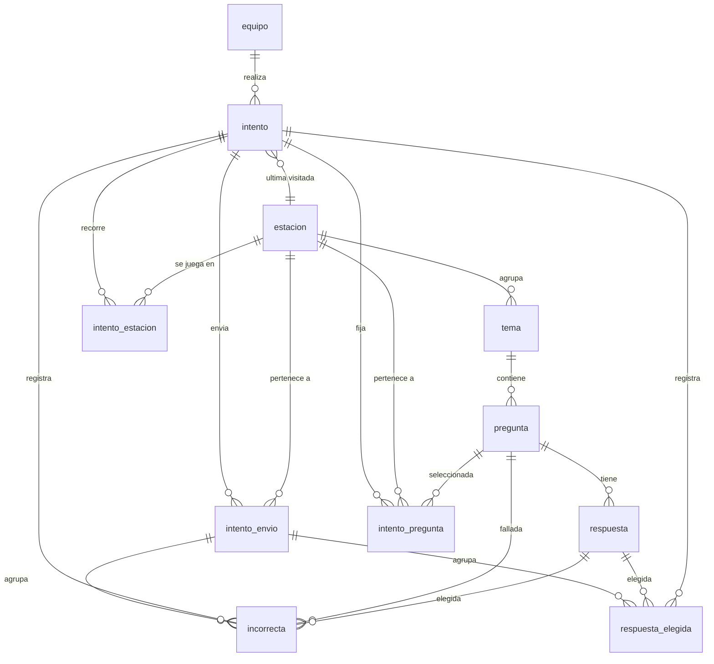

# Descripción de la base de datos

Documentación de la base **`escape_room_7b2026`** (MySQL 8, InnoDB, `utf8mb4` / `utf8mb4_unicode_ci`).

El esquema ejecutable está en `bd/schema.sql` y el contenido en los seeds `bd/seeds/001_contenido_inicial.sql`, `002_contenido_intermedio.sql` y `003_contenido_avanzado.sql`. Este documento explica el modelo para que se pueda dibujar el diagrama entidad-relación y entender cada tabla.

---

## Parte 1: cómo está pensada la base

La base está organizada en tres bloques que se conectan entre sí: **el contenido** (estaciones, temas, preguntas y respuestas), **los equipos y sus intentos** (equipo, intento y el detalle de cada recorrido) y **la configuración** del juego. La idea central es que el contenido sea reutilizable entre intentos y que cada intento quede registrado como un hecho histórico, con sus tiempos, sus ayudas y todas las respuestas que eligió el equipo.

El contenido se arma en forma de árbol. Una **estación** representa una temática del recorrido (Redes, Hardware, Internet, Ciberseguridad y Sistemas Operativos) y tiene un orden explícito de 1 a 5. Cada estación agrupa **temas** (por ejemplo, IP, Router, Redes de computadoras y WiFi dentro de Redes) y cada tema agrupa **preguntas**. Cada pregunta pertenece a un único tema y tiene una dificultad (`inicial`, `intermedio` o `avanzado`). A su vez, cada pregunta tiene varias **respuestas** posibles; en el contenido actual son siempre tres opciones y exactamente una está marcada como correcta. Las cuatro tablas de contenido usan borrado lógico mediante la columna `activo`: el juego y el panel de administración filtran `activo = 1`, pero los intentos históricos pueden seguir leyendo filas desactivadas.

Los **equipos** son independientes del contenido. Un equipo tiene un nombre único, la cantidad de integrantes (de 1 a 4) y la fecha en que se creó. Sobre un equipo se apoyan los **intentos**: cada vez que el equipo juega se crea un intento nuevo, con la dificultad elegida, la fecha de inicio, la fecha de fin, la cantidad total de ayudas, el puntaje y el estado final. El estado final puede ser `completo`, `abandono`, `por_respuestas_incorrectas` o `por_tiempo`; mientras el intento está en curso, `finalizado` queda en `NULL` y `fecha_fin` también. La columna `se_completo_ok` no se carga a mano: es una columna generada que vale 1 únicamente cuando `finalizado = 'completo'`. El campo `puntaje_obtenido` guarda los segundos totales del intento completado y queda en `NULL` en los demás casos. El intento también guarda cuál fue la última estación visitada, para poder reanudar el juego después de una recarga o de un corte.

El recorrido de un intento se registra en varias tablas de detalle. **`intento_estacion`** tiene una fila por cada estación que jugó el intento: guarda cuándo empezó y terminó esa estación, cuántas ayudas usó y si la completó. La combinación `(intento_id, estacion_id)` es única, así que no puede haber dos filas para la misma estación dentro del mismo intento. **`intento_envio`** registra cada envío del formulario de una estación, con la fecha y la cantidad de respuestas correctas e incorrectas de ese envío; esto es lo que permite mostrar "envíos: 1 de 2" y bloquear el formulario en el segundo envío. **`intento_pregunta`** congela la selección aleatoria: guarda las cuatro preguntas elegidas para cada estación del intento, con su orden. Gracias a esta tabla, recargar la página no cambia las preguntas. La combinación `(intento_id, estacion_id, orden)` es única y la combinación `(intento_id, estacion_id, pregunta_id)` también, de modo que no se repite una pregunta ni se pisan dos órdenes.

Las respuestas que elige el equipo se guardan en dos lugares. **`respuesta_elegida`** es el registro completo: cada fila apunta al intento, al envío y a la respuesta concreta, y guarda la fecha en que se respondió. **`incorrecta`** es un subconjunto: se guarda una fila por cada respuesta incorrecta, con la pregunta, la respuesta, la fecha, el intento y el envío. La duplicación es intencional: `respuesta_elegida` sirve para auditar todo lo que pasó y `incorrecta` alimenta el HUD y las estadísticas sin tener que cruzar contra `respuesta.correcta`. Ambas tablas apuntan al `intento_envio`, que es el que agrupa las respuestas de un mismo envío.

La tabla **`configuracion`** es independiente del resto: guarda pares clave/valor con los parámetros del juego y el estado de las dificultades. No tiene claves foráneas. Ahí viven, por ejemplo, `dificultad_intermedia_habilitada`, `dificultad_avanzada_habilitada`, `duracion_estacion_segundos`, `max_ayudas_estacion`, `max_envios_estacion`, `max_respuestas_incorrectas`, `max_integrantes_equipo`, `max_temas_por_estacion` y `preguntas_por_estacion`. La dificultad `inicial` no tiene interruptor: siempre está habilitada.

En resumen, para dibujar el diagrama entidad-relación hay que tener en cuenta estas relaciones:

- Un **equipo** tiene muchos **intentos**; cada intento pertenece a un solo equipo.
- Una **estación** tiene muchos **temas**; cada tema pertenece a una sola estación.
- Un **tema** tiene muchas **preguntas**; cada pregunta pertenece a un solo tema.
- Una **pregunta** tiene muchas **respuestas**; cada respuesta pertenece a una sola pregunta.
- Un **intento** tiene muchas filas de **intento_estacion**, **intento_envio** e **intento_pregunta**.
- Una **estación** aparece en muchas filas de **intento_estacion**, **intento_envio** e **intento_pregunta**.
- Una **pregunta** aparece en muchas filas de **intento_pregunta** e **incorrecta**.
- Un **intento_envio** agrupa muchas **respuesta_elegida** y muchas **incorrecta**.
- Una **respuesta** puede aparecer en muchas **respuesta_elegida** y en muchas **incorrecta**.
- Un **intento** guarda como **última estación visitada** una estación del recorrido.

### Cardinalidades

| Relación | Cardinalidad | Obligatoriedad |
| --- | --- | --- |
| `equipo` → `intento` | 1 : N | Un intento siempre tiene equipo. Un equipo puede tener 0, 1 o muchos intentos. |
| `estacion` → `tema` | 1 : N | Un tema siempre tiene estación. Una estación puede tener entre 0 y 4 temas activos. |
| `tema` → `pregunta` | 1 : N | Una pregunta siempre tiene tema. Un tema puede tener 0 o muchas preguntas. |
| `pregunta` → `respuesta` | 1 : N | Una respuesta siempre tiene pregunta. En el contenido actual cada pregunta tiene 3 respuestas. |
| `intento` → `intento_estacion` | 1 : N | Una fila por estación jugada. La pareja intento/estación es única. |
| `estacion` → `intento_estacion` | 1 : N | Una estación puede aparecer en muchos intentos. |
| `intento` → `intento_envio` | 1 : N | Muchos envíos por intento, repartidos entre estaciones. |
| `estacion` → `intento_envio` | 1 : N | Un envío siempre corresponde a una estación. |
| `intento` → `intento_pregunta` | 1 : N | Cuatro filas por estación jugada. |
| `estacion` → `intento_pregunta` | 1 : N | Una estación puede tener muchas selecciones a lo largo de los intentos. |
| `pregunta` → `intento_pregunta` | 1 : N | Una pregunta puede ser seleccionada en muchos intentos. |
| `intento_envio` → `respuesta_elegida` | 1 : N | Cada envío agrupa sus respuestas elegidas. |
| `respuesta` → `respuesta_elegida` | 1 : N | Una respuesta puede ser elegida muchas veces. |
| `intento_envio` → `incorrecta` | 1 : N | Cada envío agrupa sus respuestas incorrectas. |
| `pregunta` → `incorrecta` | 1 : N | Una pregunta puede acumular muchos errores. |
| `respuesta` → `incorrecta` | 1 : N | Una respuesta incorrecta puede repetirse en muchos intentos. |
| `intento` → `estacion` (última visitada) | N : 1 | Cada intento apunta a una estación; una estación puede ser la última de muchos intentos. |

### Diagrama entidad-relación



> `configuracion` no aparece en el diagrama porque no tiene relaciones con las demás tablas: es una tabla de pares clave/valor.

### Cómo se arma un intento, paso a paso

1. El equipo se registra en la bienvenida: se crea una fila en `equipo` (si el nombre no existía) y una fila en `intento` con `fecha_inicio`, dificultad y `ultima_estacion_visitada = 1`.
2. Al entrar a una estación, se eligen 4 preguntas y se guardan en `intento_pregunta` con su `orden` (1 a 4). También se crea la fila de `intento_estacion` con `fecha_inicio`.
3. Cada vez que el equipo envía el formulario se crea una fila en `intento_envio` con la fecha y los conteos de correctas e incorrectas.
4. Por cada respuesta marcada se inserta una fila en `respuesta_elegida`. Si la respuesta es incorrecta, además se inserta una fila en `incorrecta`.
5. Si la estación se supera, se actualiza `intento_estacion.fecha_fin`, `intento_estacion.completada = 1` y `intento.ultima_estacion_visitada`.
6. Al terminar el recorrido, se actualiza `intento.finalizado`, `intento.fecha_fin`, `intento.cantidad_ayudas` y, solo si terminó completo, `intento.puntaje_obtenido` con los segundos totales.
7. Si el intento se abandona, se agota el tiempo o se llega a 2 respuestas incorrectas, se actualiza `intento.finalizado` y `intento.fecha_fin`, pero `puntaje_obtenido` queda en `NULL`.

---

## Parte 2: detalle de cada tabla

Convenciones de tipos:

- Los identificadores son `INT UNSIGNED` autoincrementales.
- Los booleanos son `TINYINT(1)` con `0`/`1`.
- Las fechas de juego son `DATETIME(3)` (milisegundos) para que los desempates por tiempo sean precisos.
- Los valores controlados usan `ENUM`.
- Los textos cortos usan `VARCHAR`; las descripciones largas usan `TEXT`.

### `equipo`

Guarda a los equipos participantes. Es una tabla histórica: no se borra.

| Columna | Tipo | Nulo | Default | Clave | Descripción |
| --- | --- | --- | --- | --- | --- |
| `id` | `INT UNSIGNED` | No | `AUTO_INCREMENT` | PK | Identificador del equipo. Se muestra en la app como "Equipo N.º X". |
| `nombre` | `VARCHAR(120)` | No | — | UNIQUE | Nombre del equipo. Único sin distinguir mayúsculas ni acentos. |
| `cantidad_personas` | `TINYINT UNSIGNED` | No | — | CHECK 1–4 | Cantidad de integrantes. |
| `fecha_creacion` | `DATETIME` | No | `CURRENT_TIMESTAMP` | — | Fecha de alta del equipo. |

Restricciones: `uq_equipo_nombre` (único), `chk_equipo_cantidad` (`BETWEEN 1 AND 4`).

### `estacion`

Define las 5 estaciones del recorrido.

| Columna | Tipo | Nulo | Default | Clave | Descripción |
| --- | --- | --- | --- | --- | --- |
| `id` | `INT UNSIGNED` | No | `AUTO_INCREMENT` | PK | Identificador de la estación. |
| `nombre` | `VARCHAR(80)` | No | — | UNIQUE | Nombre visible (Redes, Hardware, etc.). |
| `descripcion` | `VARCHAR(255)` | No | `''` | — | Texto breve para el panel o la pantalla de transición. |
| `orden` | `TINYINT UNSIGNED` | No | — | UNIQUE | Orden del recorrido, de 1 a 5. No se debe usar el `id` para ordenar. |
| `activo` | `TINYINT(1)` | No | `1` | — | Borrado lógico. |

Restricciones: `uq_estacion_nombre` (único), `uq_estacion_orden` (único).

### `tema`

Agrupa preguntas dentro de una estación.

| Columna | Tipo | Nulo | Default | Clave | Descripción |
| --- | --- | --- | --- | --- | --- |
| `id` | `INT UNSIGNED` | No | `AUTO_INCREMENT` | PK | Identificador del tema. |
| `nombre` | `VARCHAR(80)` | No | — | — | Nombre del tema (IP, Router, etc.). |
| `estacion_id` | `INT UNSIGNED` | No | — | FK → `estacion.id` | Estación a la que pertenece. |
| `activo` | `TINYINT(1)` | No | `1` | — | Borrado lógico. |

Restricciones: `uq_tema_estacion_nombre` (único por estación), `fk_tema_estacion`. El máximo de 4 temas activos por estación se valida en la aplicación.

### `pregunta`

Contiene las preguntas de cada tema, con su nivel de dificultad.

| Columna | Tipo | Nulo | Default | Clave | Descripción |
| --- | --- | --- | --- | --- | --- |
| `id` | `INT UNSIGNED` | No | `AUTO_INCREMENT` | PK | Identificador de la pregunta. |
| `titulo` | `VARCHAR(255)` | No | — | — | Texto de la pregunta. |
| `descripcion` | `TEXT` | Sí | `NULL` | — | Mini ayuda de contexto que se muestra debajo del enunciado. Está cargada en `intermedio` y `avanzado`; las preguntas de `inicial` quedan en `NULL`. |
| `tema_id` | `INT UNSIGNED` | No | — | FK → `tema.id` | Tema al que pertenece. |
| `dificultad` | `ENUM('inicial','intermedio','avanzado')` | No | — | — | Nivel de la pregunta. |
| `activo` | `TINYINT(1)` | No | `1` | — | Borrado lógico. |

Índice: `idx_pregunta_tema_dificultad (tema_id, dificultad, activo)` para armar la selección por estación y nivel.

### `respuesta`

Opciones de cada pregunta.

| Columna | Tipo | Nulo | Default | Clave | Descripción |
| --- | --- | --- | --- | --- | --- |
| `id` | `INT UNSIGNED` | No | `AUTO_INCREMENT` | PK | Identificador de la opción. |
| `contenido` | `VARCHAR(255)` | No | — | — | Texto de la opción. |
| `correcta` | `TINYINT(1)` | No | `0` | — | 1 si es la respuesta correcta. |
| `pregunta_id` | `INT UNSIGNED` | No | — | FK → `pregunta.id` | Pregunta a la que pertenece. |
| `activo` | `TINYINT(1)` | No | `1` | — | Borrado lógico. |

Índice: `idx_respuesta_pregunta (pregunta_id, activo)`. La aplicación debe garantizar que haya exactamente una correcta por pregunta; la base no lo impone.

### `intento`

Cada partida de un equipo. Es una tabla histórica: no se borra.

| Columna | Tipo | Nulo | Default | Clave | Descripción |
| --- | --- | --- | --- | --- | --- |
| `id` | `INT UNSIGNED` | No | `AUTO_INCREMENT` | PK | Identificador del intento. |
| `equipo_id` | `INT UNSIGNED` | No | — | FK → `equipo.id` | Equipo que juega. |
| `dificultad` | `ENUM('inicial','intermedio','avanzado')` | No | `'inicial'` | — | Nivel elegido; no cambia durante el intento. |
| `fecha_inicio` | `DATETIME(3)` | No | — | — | Inicio del intento (la escribe la aplicación). |
| `fecha_fin` | `DATETIME(3)` | Sí | `NULL` | — | Fin del intento. `NULL` mientras está en curso. |
| `se_completo_ok` | `TINYINT(1)` | No | Generada | — | Columna generada: 1 solo si `finalizado = 'completo'`. |
| `cantidad_ayudas` | `SMALLINT UNSIGNED` | No | `0` | — | Total de ayudas usadas en todo el intento. |
| `puntaje_obtenido` | `INT UNSIGNED` | Sí | `NULL` | — | Segundos totales si el intento se completó; `NULL` en el resto. |
| `finalizado` | `ENUM('completo','abandono','por_respuestas_incorrectas','por_tiempo')` | Sí | `NULL` | — | Estado final. `NULL` mientras está en curso. |
| `ultima_estacion_visitada` | `INT UNSIGNED` | No | `1` | FK → `estacion.id` | Estación desde la que se reanuda. |

Índices: `idx_intento_equipo (equipo_id)`, `idx_intento_activo (fecha_fin)` para detectar intentos en curso, `idx_intento_ranking (finalizado, fecha_inicio, fecha_fin, cantidad_ayudas)` para el ranking.

### `intento_estacion`

Una fila por estación jugada dentro de un intento. Guarda el cronómetro y las ayudas de esa estación.

| Columna | Tipo | Nulo | Default | Clave | Descripción |
| --- | --- | --- | --- | --- | --- |
| `id` | `INT UNSIGNED` | No | `AUTO_INCREMENT` | PK | Identificador. |
| `intento_id` | `INT UNSIGNED` | No | — | FK → `intento.id` | Intento al que pertenece. |
| `estacion_id` | `INT UNSIGNED` | No | — | FK → `estacion.id` | Estación jugada. |
| `fecha_inicio` | `DATETIME(3)` | No | — | — | Inicio del cronómetro de la estación. |
| `fecha_fin` | `DATETIME(3)` | Sí | `NULL` | — | Fin de la estación. `NULL` si sigue en curso. |
| `ayudas` | `TINYINT UNSIGNED` | No | `0` | — | Ayudas usadas en esta estación (0 a 2). |
| `completada` | `TINYINT(1)` | No | `0` | — | 1 si la estación se superó. |

Restricciones: `uq_intento_estacion (intento_id, estacion_id)` para que no haya dos filas de la misma estación en el mismo intento.

### `intento_envio`

Cada envío del formulario de una estación.

| Columna | Tipo | Nulo | Default | Clave | Descripción |
| --- | --- | --- | --- | --- | --- |
| `id` | `INT UNSIGNED` | No | `AUTO_INCREMENT` | PK | Identificador del envío. |
| `intento_id` | `INT UNSIGNED` | No | — | FK → `intento.id` | Intento al que pertenece. |
| `estacion_id` | `INT UNSIGNED` | No | — | FK → `estacion.id` | Estación del envío. |
| `fecha` | `DATETIME(3)` | No | — | — | Momento del envío. |
| `respuestas_correctas` | `TINYINT UNSIGNED` | No | `0` | — | Correctas de ese envío. |
| `respuestas_incorrectas` | `TINYINT UNSIGNED` | No | `0` | — | Incorrectas de ese envío. |

Índice: `idx_envio_intento_estacion (intento_id, estacion_id, fecha)`. Es la fuente de verdad para el contador de envíos (máximo 2 por estación).

### `intento_pregunta`

Selección aleatoria congelada de las 4 preguntas de cada estación del intento.

| Columna | Tipo | Nulo | Default | Clave | Descripción |
| --- | --- | --- | --- | --- | --- |
| `id` | `INT UNSIGNED` | No | `AUTO_INCREMENT` | PK | Identificador. |
| `intento_id` | `INT UNSIGNED` | No | — | FK → `intento.id` | Intento al que pertenece. |
| `estacion_id` | `INT UNSIGNED` | No | — | FK → `estacion.id` | Estación de la selección. |
| `pregunta_id` | `INT UNSIGNED` | No | — | FK → `pregunta.id` | Pregunta elegida. |
| `orden` | `TINYINT UNSIGNED` | No | — | CHECK 1–4 | Posición de la pregunta en la estación (1 a 4). |

Restricciones: `uq_ip_intento_estacion_orden (intento_id, estacion_id, orden)` y `uq_ip_intento_estacion_pregunta (intento_id, estacion_id, pregunta_id)`. Así no se repiten preguntas ni órdenes.

### `respuesta_elegida`

Registro completo de todas las respuestas que eligió el equipo, correctas e incorrectas.

| Columna | Tipo | Nulo | Default | Clave | Descripción |
| --- | --- | --- | --- | --- | --- |
| `id` | `INT UNSIGNED` | No | `AUTO_INCREMENT` | PK | Identificador. |
| `fecha_respondida` | `DATETIME(3)` | No | — | — | Momento en que se eligió la respuesta. |
| `intento_id` | `INT UNSIGNED` | No | — | FK → `intento.id` | Intento al que pertenece. |
| `intento_envio_id` | `INT UNSIGNED` | No | — | FK → `intento_envio.id` | Envío que agrupa la respuesta. |
| `respuesta_id` | `INT UNSIGNED` | No | — | FK → `respuesta.id` | Opción elegida. |

Índices: `idx_re_intento`, `idx_re_envio`, `idx_re_respuesta`.

### `incorrecta`

Subconjunto de respuestas incorrectas. Duplica datos de `respuesta_elegida` a propósito.

| Columna | Tipo | Nulo | Default | Clave | Descripción |
| --- | --- | --- | --- | --- | --- |
| `id` | `INT UNSIGNED` | No | `AUTO_INCREMENT` | PK | Identificador. |
| `pregunta_id` | `INT UNSIGNED` | No | — | FK → `pregunta.id` | Pregunta fallada. |
| `respuesta_id` | `INT UNSIGNED` | No | — | FK → `respuesta.id` | Opción incorrecta elegida. |
| `fecha` | `DATETIME(3)` | No | — | — | Momento del error. |
| `intento_id` | `INT UNSIGNED` | No | — | FK → `intento.id` | Intento al que pertenece. |
| `intento_envio_id` | `INT UNSIGNED` | No | — | FK → `intento_envio.id` | Envío que agrupa el error. |

Índices: `idx_incorrecta_intento`, `idx_incorrecta_envio`.

### `configuracion`

Parámetros del juego y estado de las dificultades. No tiene relaciones.

| Columna | Tipo | Nulo | Default | Clave | Descripción |
| --- | --- | --- | --- | --- | --- |
| `clave` | `VARCHAR(80)` | No | — | PK | Nombre del parámetro. |
| `valor` | `VARCHAR(255)` | No | — | — | Valor serializado como texto. |

Valores iniciales cargados por el seed:

| Clave | Valor inicial | Uso |
| --- | --- | --- |
| `dificultad_intermedia_habilitada` | `0` | Interruptor de la dificultad intermedia. |
| `dificultad_avanzada_habilitada` | `0` | Interruptor de la dificultad avanzada. |
| `duracion_estacion_segundos` | `240` | Duración de cada estación. |
| `max_ayudas_estacion` | `2` | Ayudas máximas por estación e intento. |
| `max_envios_estacion` | `2` | Envíos máximos del formulario por estación. |
| `max_respuestas_incorrectas` | `2` | Incorrectas que eliminan al equipo. |
| `max_integrantes_equipo` | `4` | Integrantes máximos por equipo. |
| `max_temas_por_estacion` | `4` | Temas activos máximos por estación. |
| `preguntas_por_estacion` | `4` | Preguntas que se muestran por estación. |

---

## Reglas que la base no impone

Estas reglas viven en la aplicación (rutas y panel `/admin`), no en restricciones de MySQL:

- Máximo 4 temas activos por estación.
- Al menos 1 pregunta activa por tema y 4 preguntas por estación para cada nivel habilitado.
- Exactamente una respuesta correcta por pregunta.
- Máximo 2 ayudas por estación e intento.
- Máximo 2 envíos del formulario por estación.
- 2 respuestas incorrectas eliminan al intento.
- Un nivel solo se habilita si todas las estaciones tienen cobertura completa.
- Una dificultad no se deshabilita si hay intentos activos (`fecha_fin IS NULL`).
- Solo los intentos con `finalizado = 'completo'` participan del ranking.
- `puntaje_obtenido` solo se completa en intentos completados.
- El borrado de contenido es lógico (`activo = 0`); los históricos no se borran.
- La selección de preguntas se congela por intento en `intento_pregunta`.

---

## Consultas de referencia

Ranking competitivo:

```sql
SELECT i.id, e.nombre, i.fecha_inicio, i.fecha_fin,
       TIMESTAMPDIFF(SECOND, i.fecha_inicio, i.fecha_fin) AS segundos,
       (SELECT COUNT(*) FROM incorrecta inc WHERE inc.intento_id = i.id)
         AS incorrectas,
       i.cantidad_ayudas
FROM intento i
JOIN equipo e ON e.id = i.equipo_id
WHERE i.finalizado = 'completo'
ORDER BY segundos ASC,
         incorrectas ASC,
         i.cantidad_ayudas ASC,
         i.fecha_inicio ASC,
         i.id ASC;
```

Intentos activos (para bloquear el cambio de dificultad):

```sql
SELECT COUNT(*) AS activos
FROM intento
WHERE fecha_fin IS NULL;
```

Cobertura por estación, tema y nivel:

```sql
SELECT e.orden, e.nombre AS estacion,
       t.id AS tema_id, t.nombre AS tema,
       COUNT(p.id) AS preguntas_nivel
FROM estacion e
JOIN tema t ON t.estacion_id = e.id AND t.activo = 1
LEFT JOIN pregunta p ON p.tema_id = t.id AND p.dificultad = ? AND p.activo = 1
GROUP BY e.id, e.orden, e.nombre, t.id, t.nombre
ORDER BY e.orden, t.nombre;
```

Total por estación y nivel:

```sql
SELECT e.orden, e.nombre AS estacion, COUNT(p.id) AS preguntas_nivel
FROM estacion e
JOIN tema t ON t.estacion_id = e.id AND t.activo = 1
LEFT JOIN pregunta p ON p.tema_id = t.id AND p.dificultad = ? AND p.activo = 1
GROUP BY e.id, e.orden, e.nombre
ORDER BY e.orden;
```

Preguntas usadas por un intento:

```sql
SELECT ip.estacion_id, ip.orden, p.titulo
FROM intento_pregunta ip
JOIN pregunta p ON p.id = ip.pregunta_id
WHERE ip.intento_id = ?
ORDER BY ip.estacion_id, ip.orden;
```
